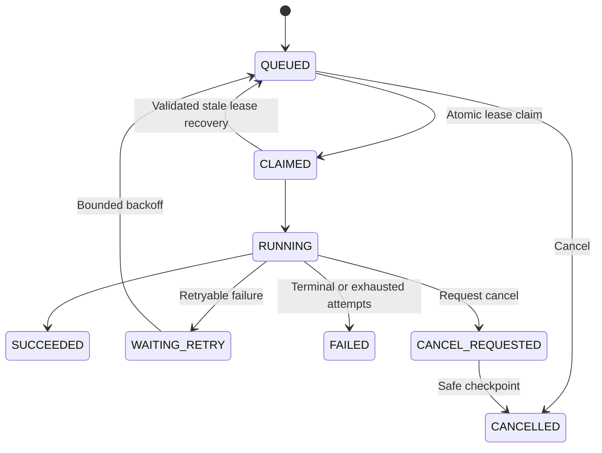
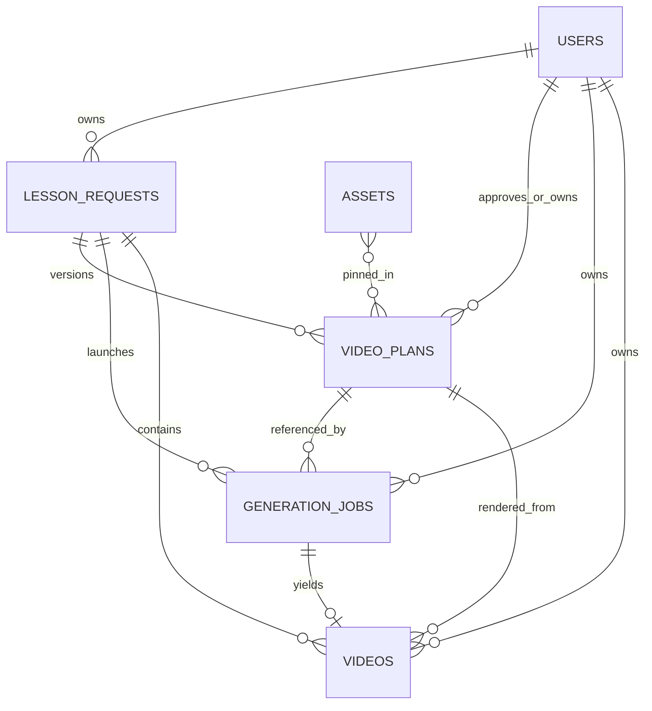

# Database Design and Data Lifecycle — Edupilo / AI Educational Story Video Platform (V1)

**Status:** Proposed design for founder/engineering review — **not an implementation approval**  
**Prepared:** 11 November 2026  
**Task:** Documentation Prompt 3 — Database Schema and Data Lifecycle  
**Authority:** `docs/PRD.md` controls product scope; `docs/DECISIONS.md` controls decision approvals; `AGENTS.md` controls implementation guardrails. This is the canonical database, storage-reference, indexing and data-lifecycle design. `docs/TECHNICAL_DESIGN.md` and `docs/SYSTEM_DESIGN.md` define the surrounding runtime architecture.

> **Status and implementation caveat.** MongoDB Atlas Free + Mongoose is **proposed**, not approved (`TECH-009`, `INC-002`). No schema, collection, indexes, migration, job queue, or retention automation is authorized by this document. The current uploaded `PROJECT_STATUS.md` predates the reported Next.js/Remotion work and cannot establish today's implementation status. Confirm the live repository separately.

## 1. Design goals, boundaries, and source reconciliation

### 1.1 What the database must support

- Adult-only ownership, with `PARENT`/`TEACHER` as a **profile preference**, not a permission tier.
- A request for one language (`en-IN` or `hi-IN`) and a selected learner level, subject, topic, and safe instruction.
- **Immutable, versioned** script and storyboard plans, generated together and reviewed before media generation.
- Deterministic lesson facts (counts, groupings, equations) and educational/safety review results.
- **One approval action → at most one logical video-generation job**, even on duplicate clicks/retries.
- Durable named stages, leases, bounded retries, sanitized failures, provider-usage visibility, and recovery checkpoints.
- Reusable licensed cartoon characters, objects, backdrops and other assets with reproducible versions.
- Private video/media references for authorized playback; never store MP4, audio, images or frame binaries in MongoDB.
- Small-data footprint suitable for local development and a potential Atlas Free metadata database, subject to measured limits.

### 1.2 Explicit non-goals and approval boundaries

V1 does **not** include child accounts, child profiles or learning histories, rosters, teacher organizations, payments, subscriptions, collaborative workspaces, quizzes, analytics, social publishing, mandatory paid generative-3D motion, or a user-facing MP4 download. V1 does require premium cinematic 2.5D output using versioned layered 3D-style assets. A `StoryProject` is represented by an existing `lessonRequests` record rather than a new workspace/project collection. A character's versioned catalogue entry and its layers/poses remain `assets` records rather than a separately approved user-owned character editor.

**Approval-sensitive areas:** authentication (`TECH-017`), MongoDB/Mongoose (`TECH-009`), worker persistence (`TECH-010/011`), adult-gate final signoff (`OPS-001`, `INC-003`), child privacy (`OPS-002`), retention/deletion (`TECH-018`), subject taxonomy (`PROD-005`), and hosted media access/lifecycle (`TECH-015` configuration). No implementation may silently resolve them.

### 1.3 Entity mapping — prompt-pack vocabulary vs established V1 schema

| Prompt-pack concept | Baseline V1 representation | Design decision |
|---|---|---|
| Adult/User | `users` | Baseline candidate |
| Workspace | **None** | Defer; no collaboration/organizations in V1 |
| StoryProject | `lessonRequests` | Existing project/request aggregate; avoid duplicate collection |
| Storyboard/versioned scenes | `videoPlans` with embedded scene array | Immutable revision snapshots |
| CharacterProfile | `assets` rows with `kind=CHARACTER` | Versioned reusable approved character sheet; no user-owned character feature |
| GenerationJob | `generationJobs` | Durable work state and leases |
| GenerationAttempt | Bounded `generationJobs.attemptLog` **proposed extension** | Separate collection only if measured scale/retention requires it |
| ProviderConfig | Identifiers/config-version fields on plans/jobs/assets | **Never** raw API keys/secrets; separate table not required |
| ProviderUsage | Bounded `generationJobs.usage` entries | Separate ledger only if quota/audit requirements justify it |
| Script/scene image/audio/caption/thumbnail/final assets | Asset catalogue in `assets`; stage artifacts referenced in job checkpoints; final media in `videos` | No binary BLOBs, and no invented upload flow |
| VideoRender | `videos` | Existing final-output metadata; internal MP4, protected playback |
| Moderation/educational validation | `videoPlans.validation`, reviewer findings and job validation checkpoints | No standalone moderation service or table by default |
| Audit history | Immutable plan versions, approval metadata, job attempts/checkpoints | More comprehensive audit-event collection is an **optional proposal** |

**Smallest baseline:** six collections — `users`, `lessonRequests`, `videoPlans`, `generationJobs`, `assets`, `videos`. All additional fields below remain proposals unless separately approved in `docs/DECISIONS.md`.

## 2. Database selection and conventions

### 2.1 Recommended candidate and alternative

**Candidate: MongoDB Atlas Free + Mongoose.** Fits nested bounded scene plans and current proposed TypeScript stack; indexed owner-scoped queries can serve a simple recent-project experience. **But** `TECH-009` remains proposed and Atlas Free capacity, indexes, operational limits, transaction support in the chosen deployment and current pricing must be verified before adoption. Store **metadata only**.

**Alternative for approval if MongoDB is not selected:** PostgreSQL with a normalized owner/project/job structure and JSONB for immutable versioned storyboards. It offers relational constraints and transactional approval/job creation, at the cost of a schema migration and different querying/modeling work. This is a **candidate alternative**, not a return to an approved PostgreSQL architecture. A local MongoDB server is a development option only if separately approved.

### 2.2 Common type and authorization rules

| Convention | Proposed rule |
|---|---|
| Identifiers | MongoDB `_id: ObjectId`; references as `ObjectId`. Client receives opaque strings; no trust based on possession of an ID. |
| `ownerId` | Required on owner-owned lessons/plans/jobs/videos; set from authenticated **adult session on server** only. |
| Time | UTC `Date`, with `createdAt`, `updatedAt` on mutable records and `createdAt` on immutable plans. |
| Versioning | Immutable `videoPlans` content; `version` starts at 1; controlled counters/optimistic concurrency for mutable lessons/jobs. |
| Enums | Reject unknown role, locale, job state/stage, asset kind and render status. |
| Text limits | Bound all instructions/narration/scene fields, array lengths, provider fields and error messages; exact numeric caps require implementation evaluation. |
| Media | Private object keys/paths, MIME, checksum, bytes and codec metadata only; no signed/public URLs persisted. |
| Secrets | Provider ID, model, voice, config revision and usage are allowed; API keys, bearer tokens and raw sensitive request/response dumps are not. |
| Deletion | No speculative TTL/automatic purge until owner-approved retention, privacy and backup policies. |
| Money | If usage cost tracked, store decimal/whole minor units and currency with pricing-snapshot version; label estimates, never imply billing capability. |
| Schema versions | `schemaVersion` on plan contract; application data migrations tracked separately. |

**Cross-record invariants** are enforced in the service/repository layer and, where supported, transactions: a plan's `ownerId` equals the parent lesson owner; a job's lesson and plan belong to the same adult; a video references a completed generation job for its approved plan; no one can approve/stream another user's content. An ObjectId reference alone does not enforce these constraints in MongoDB.

## 3. Baseline entities: fields, indexes, ownership, lifecycle

**Legend:** `R` required; `O` optional/nullable; `C` conditional; `D` derived/default. Proposed fields beyond the original six-collection schema are tagged **extension**. All index definitions are proposed until implementation approval. Do not create indexes blindly on an unmeasured free-tier cluster.

### 3.1 `users` — adult account/profile

**Purpose:** Map an authenticated adult principal to non-sensitive product preferences and consent records. No child identity.

| Field | Type / presence | Default or validation |
|---|---|---|
| `_id` | ObjectId · R | MongoDB-generated |
| `authSubject` | string · R | Unique opaque ID from **selected** auth solution; auth method pending |
| `emailNormalized` | string · O | Normalized email only if needed; no assumption of password ownership |
| `rolePreference` | `PARENT \| TEACHER` · O | Experience preference; cannot elevate rights |
| `preferredLanguage` | `en-IN \| hi-IN` · O | UI default only; request locale stored independently |
| `consentVersions` | `{policyId: acceptedAt}` map · O | Versioned evidence; policies still pending |
| `status` | `ACTIVE \| SUSPENDED \| DELETION_PENDING` · R | `ACTIVE` only after valid adult registration/session |
| `createdAt`, `updatedAt` | Date · R | Server-managed |

**Indexes:** unique `{authSubject:1}`; optional unique **partial** index on `emailNormalized` where it is a string; do not expose public listing. `status` index only if measured operations need it. **Ownership:** user can read/update only own allowed preferences; `authSubject` and status are privileged fields. **Lifecycle:** suspend blocks access; delete/pseudonymize behavior is open (`TECH-018`). Never add date of birth, child name, child voice/photo, school, class roster or password fields without approved scope/auth design.

### 3.2 `lessonRequests` — StoryProject / request aggregate

**Purpose:** Adult-owned lesson input and lightweight workflow state. There is no separate project/workspace table in V1.

| Field | Type / presence | Default or validation |
|---|---|---|
| `_id`, `ownerId` | ObjectId · R | `ownerId → users`; owner-derived only |
| `learnerLevel` | enum · R | Approved Nursery/KG/Class 1–4 taxonomy; exact keys pending |
| `subjectKey`, `topicKey` | string · R | Restrict to **approved initial** taxonomy; sample values are illustrative |
| `language` | `en-IN \| hi-IN` · R | Single requested narration locale |
| `instruction` | string · R | Length-bound, Unicode-normalized, escaped on display; no unnecessary child data |
| `preferredContext` | bounded object · O | Safe character/scenario keys only; do not add child identifiers |
| `status` | `DRAFT \| PLANNING \| REVIEW_READY \| APPROVED \| ARCHIVED` · R | `DRAFT` initially; must reflect latest plan state |
| `currentPlanVersion` | integer ≥0 · R | `0` until first plan; update atomically |
| `inputRevision` | integer ≥1 · **extension** | `1` initially; supports edit race/idempotency isolation |
| `createdAt`, `updatedAt` | Date · R | UTC |

**Indexes:** `{ownerId:1, updatedAt:-1, _id:-1}` for recent list and stable cursor; `{ownerId:1,status:1}` only if filter UX requires. **Mutable:** draft input, preference, status and version pointer under guarded transitions. **Immutable:** historical plan content stays in `videoPlans`, never overwritten by edit. **Lifecycle:** `ARCHIVED` must not imply media deleted; retention is open. Owner-scoped read/write is mandatory.

### 3.3 `videoPlans` — versioned script and storyboard

**Purpose:** Store a single coherent script+storyboard from the creator, schema-valid facts, reviewer findings, and exact adult approval. **Immutable content versions** are critical to reproducibility and safety.

| Field | Type / presence | Default or validation |
|---|---|---|
| `_id`, `ownerId`, `lessonRequestId` | ObjectId · R | Same adult owner as lesson |
| `version` | positive integer · R | Starts at 1; unique within lesson |
| `schemaVersion` | string · R | Supported structured-plan version, e.g. `1.0` (example) |
| `generator` | bounded object · O/C | Provider/model/config revision, usage summary, latency; no secrets |
| `reviewer` | bounded object · O/C | Provider/model, structured findings, disposition; no raw sensitive response |
| `lesson` | embedded object · R once valid | Objective, level, locale, title; matches request |
| `story` | embedded object · R once valid | Premise/summary within caps |
| `scenes` | bounded array · R once valid | Ordered scene IDs, purpose, narration, visual intent, allowed asset IDs/actions, typed facts, captions/cues, time estimate |
| `validation` | bounded object · R once valid | Schema/age/math/semantic/safety outcomes and reviewed rule versions |
| `status` | `GENERATING \| INVALID \| REVIEW_READY \| APPROVED \| SUPERSEDED` · R | No approved content without full required validation |
| `contentHash` | string · C | Required for `REVIEW_READY` or `APPROVED`; hash canonical immutable content |
| `approvedBy`, `approvedAt` | ObjectId / Date · C | Both populated only for approved exact version |
| `approvalHash` | string · **extension** · C | If stored, must equal `contentHash`; otherwise rely on existing content hash |
| `createdAt` | Date · R | Immutable content creation timestamp |

**Indexes:** unique `{lessonRequestId:1,version:1}`; `{ownerId:1,lessonRequestId:1,version:-1}`; consider optional unique `{lessonRequestId:1,contentHash:1}` only after validating regeneration behavior. **Immutable:** `schemaVersion`, `lesson`, `story`, `scenes`, `validation` result **snapshots**, content hash and version after review-ready; only controlled status/approval metadata may change. New content means **new plan version**. If reviewer/validation results need updating, create a new reviewed snapshot or version rather than rewriting the approved teaching content. **Ownership:** adult user alone may approve an owned, validated version; reviewer cannot approve on adult's behalf.

**Required scene subdocument (illustrative, not final schema):**

```ts
{
  sceneId: string;                       // unique within plan
  learningPurpose: string;
  narration: string;                     // approved text, locale validated
  visualIntent: string;
  assets: string[];                      // allowlisted, version-pinnable asset refs
  facts?: { groups?: number; itemsPerGroup?: number; total?: number; equation?: string };
  actions: Array<{ type: string; [validatedField: string]: unknown }>;
  captionCues?: string[];                // recompute timed captions from audio
  estimatedDurationMs: number;           // estimate, not final authoritative timing
}
```

**Math invariant:** for the approved rabbit sample, `groups=3`, `itemsPerGroup=2`, `total=6`, and equations `2+2+2=6`, `3×2=6` must match actual rendered object layout. Never trust image-model or LLM text as the source of exact count truth.

### 3.4 `generationJobs` — work state, attempts and cost

**Purpose:** Persist logical planning/generation operations, atomic claims, stage checkpoints, bounded retry behavior, and sanitized provider usage.

| Field | Type / presence | Default or validation |
|---|---|---|
| `_id`, `ownerId`, `lessonRequestId` | ObjectId · R | Owner and lesson match |
| `videoPlanId` | ObjectId · C | Required for `VIDEO_GENERATION`; references validated **APPROVED** plan |
| `type` | `PLAN_GENERATION \| VIDEO_GENERATION \| STAGE_RETRY` · R | Retry semantics must not bypass original approval |
| `state` | job-state enum · R | `QUEUED` initially; see §4 |
| `stage` | stage enum · C | One of approved named stages; nullable when queued before stage |
| `idempotencyKey` | opaque string · R | Unique per logical operation; store fingerprint/hash rather than child text |
| `inputHash` | string · **extension** · C | Binds operation to exact normalized inputs/config |
| `attempts`, `maxAttempts` | non-negative integers · R | `0` and approved bounded max; exact max pending |
| `leaseOwner`, `leaseExpiresAt`, `heartbeatAt` | string / Date / Date · O | Atomic claim and stale recovery; never treated as perpetual lock |
| `cancelRequestedAt` | Date · O | Checked at safe checkpoints |
| `checkpoints` | bounded subdocument array · R | Stage/attempt/times/content hash and **private artifact references** |
| `attemptLog` | bounded subdocument array · **extension** | `attemptNo`, `stage`, status, started/ended, retry classification, sanitized error; only if needed |
| `usage` | bounded subdocument array · R/O | Provider/model/voice/config, requests, tokens/chars, time, pricing snapshot and **estimated** cost |
| `error` | sanitized object · O | Stable code, stage, retryable, safe message; no raw payload/secret |
| `createdAt`, `updatedAt`, `startedAt`, `finishedAt` | Date · C | UTC; start/finish conditional |

**Indexes:** unique `{idempotencyKey:1}`; `{state:1,createdAt:1}` for worker claims; `{leaseExpiresAt:1}` for stale recovery; `{ownerId:1,updatedAt:-1}` for project status; `{videoPlanId:1,type:1}` for generation relationship. **Mutable:** claimed state, lease, heartbeat, bounded checkpoint/usage entries, sanitised error; completed attempts are append-only snapshots. **Ownership:** web API creates jobs only for current authenticated adult; worker service identity accesses claimed work; users cannot modify lease/state directly.

**Job/attempt distinction:** one `generationJobs` record is a **logical job**. `attempts` counts executions/retries, `attemptLog` is optional per-attempt evidence, while `checkpoints` capture successful stage outputs. A second `generationAttempts` collection is **not** required by current V1 scope; if attempts or media records grow beyond bounded-document limits, propose a separate retention-aware collection after observing usage.

### 3.5 `assets` — shared licensed character/object catalogue

**Purpose:** Manage reproducible, approved, reusable illustrations and supporting graphics/audio. The catalogue is **not** a personal video library or unrestricted user asset-upload system.

| Field | Type / presence | Default or validation |
|---|---|---|
| `_id` | ObjectId · R | MongoDB-generated |
| `logicalKey` | string · R | E.g. `character.rabbit.ria`, stable symbolic identity |
| `version` | integer ≥1 · R | Exact revision, immutable after publication |
| `kind` | enum · R | `CHARACTER`, `OBJECT`, `BACKGROUND`, `ICON`, `FONT`, `MUSIC`, `SFX` |
| `format` | enum · R | `SVG`, `PNG`, `JSON`, `AUDIO`, `FONT` when supported |
| `styleFamily` | string · R | Reusable consistent illustration family |
| `layers`, `poses`, `expressions`, `actions` | bounded arrays · O | Only supported capabilities, e.g. eye blink, hop pose, carrot placement |
| `storageRef` | private media-reference object · R | Backend, private key/path, SHA-256, MIME, byte size; no public URLs |
| `provenance` | object · R | Originator/source/creation method and relevant evidence; minimize raw prompt retention |
| `license` | object · R | License/version, allowed commercial use, attribution/evidence reference |
| `approvalState` | `DRAFT \| REVIEW_REQUIRED \| APPROVED \| REJECTED \| RETIRED` · R | Only `APPROVED` enters final render |
| `createdAt`, `updatedAt` | Date · R | Preserve version history |

**Indexes:** unique `{logicalKey:1,version:1}`; `{kind:1,styleFamily:1,approvalState:1}` for asset resolution. **Mutable:** `approvalState`/review metadata under privileged process; published bytes/version don't change (new version on change). **Ownership:** controlled internal/shared assets; no user-owned asset CRUD is assumed. **Lifecycle:** never delete a referenced asset version without an approved migration/retention policy; retirement prevents new use, not silent destruction of prior render provenance.

**CharacterProfile mapping:** A rabbit character is represented by `assets(kind=CHARACTER, logicalKey=character.rabbit.ria, version=N)` with layers, named expressions, poses, actions and style family. A separate `CharacterProfile` table, per-user character builder or style approval workflow is **not** approved V1 scope.

### 3.6 `videos` — final render metadata

**Purpose:** Track the validated final/private MP4 and make playback authorization/recovery possible without persisting the media bytes or a permanent public URL.

| Field | Type / presence | Default or validation |
|---|---|---|
| `_id`, `ownerId`, `lessonRequestId`, `videoPlanId`, `generationJobId` | ObjectId · R | Same adult/plan; render job must be tied to approved version |
| `status` | `PROCESSING \| READY \| FAILED \| EXPIRED \| DELETION_PENDING` · R | `READY` only after valid media inspection |
| `mediaRef` | private-reference object · C | Required when READY; backend, key/path, checksum, MIME; not signed URL |
| `durationMs`, `width`, `height`, `fps` | positive numbers · C | Required when READY; exact profile must be approved/test-labeled |
| `videoCodec`, `audioCodec`, `audioSampleRate` | string/string/number · C | Required when READY; validated streams |
| `language` | `en-IN \| hi-IN` · R | Must equal approved plan locale |
| `fileSizeBytes` | integer ≥0 · C | Required when READY |
| `validation` | bounded object · C | Stream integrity, sync/language, dimensions, educator-review summary |
| `renderProfileVersion` | string · **extension** · C | Snapshot of test/approved quality configuration |
| `retentionClass`, `expiresAt` | string / Date · O | Values not set until retention approved |
| `createdAt`, `updatedAt` | Date · R | UTC |

**Indexes:** `{ownerId:1,createdAt:-1}`; unique `{generationJobId:1}` (one video record per logical render job); `{status:1,expiresAt:1}` **only after retention rules approved**. **Mutable:** processing status and validation/media metadata until READY; READY artifact itself is immutable — revisions should create a new video/job record. **Ownership:** only owner-authorized playback session via server; client never gets private key/database credential. **Lifecycle:** `EXPIRED`/`DELETION_PENDING` states are vocabulary, not permission to silently purge unapproved assets. No user-facing MP4 download endpoint.

**Cardinality warning:** the original design allows one `videos` record per `generationJobId`. Multiple intentional render profiles/regenerations **could** result in multiple jobs/videos per approved plan; whether V1 exposes variants or only the most recent ready video is an open UX decision. Do not enforce a unique index on `videoPlanId` without that decision.

## 4. States and allowed transitions

### 4.1 Lesson request state — candidate application guards

| From | To | Condition |
|---|---|---|
| new | `DRAFT` | Valid adult-owned request created |
| `DRAFT` | `PLANNING` | One idempotent `PLAN_GENERATION` job created |
| `PLANNING` | `REVIEW_READY` | Latest plan validates and is ready for adult review |
| `PLANNING` | `DRAFT` | Planning failed; input preserved and error surfaced via job |
| `REVIEW_READY` | `PLANNING` | Adult requests scoped revision producing a *new* plan version |
| `REVIEW_READY` | `APPROVED` | Adult approves immutable hash/version; render job created atomically |
| `APPROVED` | `ARCHIVED` | Only explicit, allowed archive policy; **not** media deletion |

This simplifies existing status vocabulary; real editing/revision transitions require approval of job and UX semantics. Status stored on lesson is a **summary**, not the authoritative audit record: plan approval evidence belongs to the exact plan version.

### 4.2 Video-plan state — candidate guards

```text
GENERATING → INVALID                   validation failed; no approval
GENERATING → REVIEW_READY              required checks passed
REVIEW_READY → APPROVED                adult owner approves exact contentHash
REVIEW_READY → SUPERSEDED              new reviewable version replaces it
APPROVED → SUPERSEDED                  only if policy permits, never unapprove past work
INVALID → [new plan version]           do not mutate invalid plan into different content
```

Any edited narration, scene order, numbers, educational text, language or referenced asset manifest creates a new immutable content version and requires new validation/approval; never render directly from `REVIEW_READY` or `SUPERSEDED` unless a valid prior approval record remains and the architecture explicitly permits the action.

### 4.3 Generation job machine state



**Stage enum:** `PLANNING`, `SEMANTIC_REVIEW`, `ASSET_RESOLUTION`, `NARRATION`, `TIMING`, `COMPOSITION`, `RENDERING`, `POST_PROCESSING`, `STORAGE`, `VALIDATION`. `state` is the machine lifecycle; `stage` is the current work the user can understand. No invented percentages. Exact lock times/backoff/retry counts remain pending tests. Failed non-retryable safety/licensing/authorization checks must not auto-resume as though transient.

### 4.4 Asset and video lifecycle

- `assets`: `DRAFT → REVIEW_REQUIRED → APPROVED | REJECTED`; `APPROVED → RETIRED` only by permitted asset governance; reapproval/rollback needs explicit policy. Pending or rejected assets cannot render a final video.
- `videos`: `PROCESSING → READY | FAILED` after verification. Later `READY → EXPIRED | DELETION_PENDING` requires approved retention/access policy. Missing/corrupt outputs cannot be marked READY.
- There is **no automatic account/asset/video deletion transition** established by the source documents. Do not write TTL workers or cascade deletes yet.

## 5. Relationships and authorization



- A `user` may own multiple lesson requests; a lesson request has multiple **immutable** plan versions; one approved plan can be referenced by a video job and potentially a subsequent safe retry job.
- A render job produces at most one final video metadata record (`generationJobId` unique). Other intermediate media are **private stage artifacts** referenced from checkpoints, not publicly playable `videos`.
- `assets` catalogue entries are shared/versioned; a plan should pin exact asset versions or an immutable resolved asset manifest before the render. A logical name without a version cannot guarantee later reproducibility.
- Queries for lessons/plans/jobs/videos must include a **server-derived** `ownerId` filter. Lookup by `_id` then check ownership is insufficient for the standard access path; owner mismatch should return indistinguishable inaccessible/not-found behavior.
- Approval requires authenticated adult owner, a matched current plan version and content hash, passing validation, and a transactionally/idempotently created job. A provider reviewer never changes approval authority.
- Videos are authorized by lesson/plan/job/owner chain, then streamed or served via short-lived signed playback URL. **Never** persist signed URLs in metadata or expose permanent object links.

## 6. Reproducibility, generation attempts, and provider usage

### 6.1 Reproducible storyboard versions

Each `videoPlans` version should pin: schema version, exact ordered scenes, objective/language, structured facts and approved narration, supported action IDs, asset-version references (or hash of immutable manifest), creator/reviewer model IDs and config revision, deterministic-validation ruleset version, `contentHash`, and adult approval metadata. Compute `contentHash` from canonicalized **content**, excluding mutable state/timestamps/usage; pin the canonicalization rule version to avoid future false mismatches. The source contract already includes version, hash, status, and approvals; **canonicalization/version fields are implementation proposals**.

Rendering can use additional `renderProfileVersion`, `TTS` provider/model/voice/settings hashes, normalized timing and media/asset checksums in `generationJobs.checkpoints`. Regeneration of *identical* inputs should safely reuse cached artifacts only if privacy, rights, idempotency and approved-plan rules permit it. Do not overwrite the approved plan or last successful final file.

### 6.2 One logical job, multiple bounded attempts

**Proposed embedded attempt shape (not a new collection):**

```json
{
  "attemptNo": 2,
  "stage": "NARRATION",
  "provider": "elevenlabs",
  "model": "<approved-evaluation-model-id>",
  "voice": "<approved-evaluation-voice-id>",
  "startedAt": "2026-11-11T10:04:00Z",
  "finishedAt": "2026-11-11T10:04:04Z",
  "result": "RETRYABLE_FAILURE",
  "errorCode": "PROVIDER_RATE_LIMIT",
  "retryAfterMs": 1500,
  "inputHash": "sha256:<hex>",
  "artifactRef": null
}
```

Never store raw API tokens, signed URLs, proprietary provider request/response bodies, learner personal details, or speech text redundantly in attempt logs. Any `inputHash` must be non-reversible enough for the threat model (consider keyed hashing for low-entropy/personal inputs); a hash does not automatically anonymize data.

**When a separate `generationAttempts` table might be justified:** real retained attempt logs become too large for safe bounded arrays, compliance requires append-only event retention, or reliable reconciliation needs independently queryable provider calls. It is **not** required for the initial six-collection design; request a documented schema/retention decision before adding it.

### 6.3 Provider configuration references, usage and cost

- Provider configuration **identity only**: provider, exact model/voice ID, locale, model/settings version, revision/hash, API operation, and a safe environment label. Actual secrets remain in server/worker secret configuration.
- Usage entries inside `generationJobs.usage` can hold input/output tokens, TTS characters, call count, duration, latency, retries, cache hit, HTTP category, estimated cost/currency and versioned pricing assumption. If a charge is not determinable, record it as `unknown` rather than `0`.
- Azure is **superseded** as active TTS evaluation default. ElevenLabs is approved **only for internal free-tier Phase 0 evaluation** (`TECH-006`), and its output is not approved for commercial/public use. Gemini and Groq have approved Phase 0 *directions*, not pinned model configurations.
- Treat all quota and pricing information as runtime configuration subject to re-verification. No paid usage, billing details, new provider or expanded training-data disclosure without explicit approval.
- **Separate `providerUsage` collection:** an optional future proposal if a central spend ledger, cross-job reconciliation or usage auditing is actually required; not a baseline collection.

### 6.4 Moderation and educational validation metadata

Store bounded structured outcomes on each plan: `schemaValid`, `mathValid`, `ageReview`, `semanticReview`, `safetyDisposition`, `reviewRuleVersion`, `reviewedAt`, and concise per-scene findings (`sceneId`, severity, rule, safe summary). The exact sensitive-topic policy/owner is **pending**, so category-specific automated moderation is a design placeholder, not an already approved enforcement policy. Keep routine logs free of raw child/prompt text. A model reviewer is advisory; math determinism and adult approval remain separate gates.

## 7. Media references and data lifecycle

### 7.1 Private media reference contract — proposal

```ts
{
  backend: 'LOCAL' | 'R2';        // hosted R2 direction approved; config open
  objectKey: string;               // private opaque path/key; never direct public URL
  sha256: string;
  mimeType: string;
  sizeBytes: number;
  // for media as applicable:
  durationMs?: number;
  width?: number;
  height?: number;
  // createdAt and provenance stored with owning record
}
```

Local POC files should use safe opaque paths under an application-owned media directory; hosted assets/videos should use private R2 bucket objects with authenticated service access. Proposed key pattern from current system design: `projects/{ownerId}/{lessonId}/{artifactType}/{artifactVersion}/{opaqueFilename}`. Avoid names, user-provided paths and permanent public URLs. Check MIME/type, size, duration/resolution, checksum, rights and educational validation before `videos.status=READY`.

### 7.2 Retention and deletion matrix — **not yet approved**

| Data/media | Working purpose | Proposed handling *before policy signoff* | Open decision |
|---|---|---|---|
| Adult profile (`users`) | Session/consent/preferences | Keep minimum fields; restrict access | Account deletion, statutory retention, consent versions |
| Lesson input (`lessonRequests`) | Draft/revision and safe recovery | Protect by owner; do not log verbatim | User deletion/export, text retention |
| Plan snapshots (`videoPlans`) | Audit/reproduce approved teaching content | Immutable version reference; do not purge automatically | Past-version retention, safety evidence, backups |
| Generation jobs and attempts | Retries, usage, failure diagnosis | Bound logs and checkpoint metadata; sanitize | Operational retention and aggregation window |
| Reusable catalogue assets (`assets`) | Character consistency and license evidence | Version/pin references; restrict editing | Retirement, attribution evidence retention |
| Narration/scene frames/draft previews | Intermediate media for resume and review | Keep private; manual cleanup only under explicit developer procedure | TTL and cleanup rules, failure artifacts |
| Final videos (`videos` + MP4 in private storage) | Authorized replay | No public download, signed sessions only when configured | Expiry promise, deletion, storage cap, backups |
| Signed URLs | Temporary playback authorization | **Do not store** in DB or logs | Validity duration; revocation strategy |
| Provider usage/audit metadata | Cost transparency, safe retries | Keep sanitized minimal record | Exact retention/privacy scope |

**Delete flow — conditional proposal only, not an authorized implementation:** authenticate adult → authorize project/account scope → mark lifecycle request → stop or cancel active jobs at safe checkpoints → collect *owner-scoped* metadata and referenced private objects → delete eligible objects + records under approved retention rules → reconcile failures/orphans → record safe completion evidence. Backups, legal holds, consent rules and storage-provider behavior must be specified before implementing. Do not add MongoDB TTL indexes, cascading deletes, job-based purge, or a promise of indefinite storage now.

### 7.3 Storage limits, growth and orphan reconciliation

- Do not store videos/audio/frames in MongoDB, GridFS, oversized arrays or base64 embedded JSON.
- Put only **bounded** scenes/attempts/checkpoints/usage in documents; pagination and external artifacts reduce growth. MongoDB document size and Atlas Free capacity require measurement with sample plans/jobs and indexes.
- When generating media: write object to private temporary storage → verify streams/hash/size → publish validated metadata to the ready state atomically as feasible. If metadata commit fails, keep a private orphan marker for later **approved** reconciliation; never mark corrupt media as READY.
- A future reconciliation sweep may compare private object keys to referenced manifests/checkpoints, but automatic deletion of unreferenced objects is deferred until retention/lifecycle approval.
- For R2, require private bucket access, owner authorization, short-lived playback grants, correct CORS, and an approved signed-URL expiry; R2 selection does **not** settle these settings.

## 8. Idempotency and atomicity

**Plan generation:** define one operation identity from `{ownerId, lessonRequestId, inputRevision, operationId}`, store a server-generated opaque `idempotencyKey` (or its stable digest), and use a **unique index** to return the existing job on duplicate requests. Do not include raw instruction in the key.

**Video generation:** enforce `{ownerId, approvedPlanId, contentHash, renderProfileVersion, logicalOperationId}` in the deduplication contract. Atomically update the exact plan from `REVIEW_READY` to `APPROVED` (with adult ID/time) **and** persist one `VIDEO_GENERATION` job, with a consistent approved content hash. Multiple button clicks must return the same job, not charge twice. If the chosen MongoDB environment supports required transactions, implement in one transaction; **verify actual deployment support**. If not, design and approve a transactional-outbox/recovery alternative rather than pretending two ordinary writes are atomic.

**Worker claim:** atomic compare-and-set `QUEUED → CLAIMED` with a lease, idempotent stage completion, heartbeat and safe stale-recovery checks. Prefer replaying a known successful checkpoint rather than issuing duplicate paid-provider requests. Concurrent retries must not create two READY objects under one generation job. Every provider call should receive a safely deduplicated operation identity where supported; not all third-party APIs provide true request idempotency.

**Revision:** a new plan version cannot mutate previously approved narration or counts; any changed facts/narration invalidate prior approval. Approval hash guards against stale browser tabs. Exact transaction semantics, retry counts and job persistence technology still require founder/engineering signoff.

## 9. Worked example: English and Hindi rabbit lesson

These are **illustrative metadata examples, not real database records or proof that services ran**. The approved language model is one locale per `lessonRequests` record, so English and Hindi are shown as **two adult-owned requests** with the same intended educational facts. Grouping multiple locales under one user-facing project would require an explicit schema/UX change; do not assume it.

**Example adult user:**

```json
{
  "_id": "650000000000000000000001",
  "authSubject": "auth_provider_opaque_adult_001",
  "rolePreference": "TEACHER",
  "preferredLanguage": "en-IN",
  "status": "ACTIVE",
  "createdAt": "2026-11-11T09:00:00Z"
}
```

**English lesson and its versioned plan:**

```json
{
  "lessonRequest": {
    "_id": "650000000000000000000011",
    "ownerId": "650000000000000000000001",
    "learnerLevel": "CLASS_2",
    "subjectKey": "MATH",
    "topicKey": "MULTIPLICATION_EQUAL_GROUPS",
    "language": "en-IN",
    "instruction": "Explain multiplication using a rabbit and carrots.",
    "status": "APPROVED",
    "currentPlanVersion": 1
  },
  "videoPlan": {
    "_id": "650000000000000000000021",
    "ownerId": "650000000000000000000001",
    "lessonRequestId": "650000000000000000000011",
    "version": 1,
    "schemaVersion": "1.0",
    "lesson": {"objective": "Understand equal groups", "learnerLevel": "CLASS_2", "language": "en-IN", "title": "Ria Rabbit's Carrot Groups"},
    "story": {"premise": "Ria sorts carrots fairly", "summary": "Three baskets with two carrots each"},
    "scenes": [
      {
        "sceneId": "scene-03",
        "learningPurpose": "Demonstrate equal groups",
        "narration": "There are three baskets with two carrots in each. That makes six carrots.",
        "visualIntent": "Reveal exactly three baskets and distribute exactly two carrots into each",
        "assets": ["character.rabbit.ria@1", "object.basket@1", "object.carrot@1"],
        "facts": {"groups": 3, "itemsPerGroup": 2, "total": 6, "equation": "3 × 2 = 6"},
        "actions": [{"type": "REVEAL_GROUPS", "count": 3}, {"type": "DISTRIBUTE_ITEMS", "itemsPerGroup": 2}],
        "captionCues": ["three groups", "two in each group"],
        "estimatedDurationMs": 9000
      }
    ],
    "validation": {"schemaValid": true, "mathValid": true, "semanticReview": "PASS", "safetyDisposition": "REVIEWED"},
    "status": "APPROVED",
    "contentHash": "sha256:example-english-content-hash",
    "approvedBy": "650000000000000000000001",
    "approvedAt": "2026-11-11T09:20:00Z"
  }
}
```

For illustration, this is **one sample scene excerpt**, not the full required five-scene validated plan. `contentHash` is a placeholder and should be computed for real; `MATH`/topic keys are **example values**, not a founder-approved taxonomy. The example `REVIEWED` safety disposition is a conceptual mock outcome, not evidence that a moderation policy has been finalized.

**Hindi lesson and plan (equivalent typed facts):**

```json
{
  "lessonRequest": {
    "_id": "650000000000000000000012",
    "ownerId": "650000000000000000000001",
    "learnerLevel": "CLASS_2",
    "subjectKey": "MATH",
    "topicKey": "MULTIPLICATION_EQUAL_GROUPS",
    "language": "hi-IN",
    "instruction": "एक खरगोश और गाजर की मदद से गुणा समझाइए।",
    "status": "REVIEW_READY",
    "currentPlanVersion": 1
  },
  "videoPlan": {
    "_id": "650000000000000000000022",
    "ownerId": "650000000000000000000001",
    "lessonRequestId": "650000000000000000000012",
    "version": 1,
    "schemaVersion": "1.0",
    "lesson": {"objective": "समान समूहों के रूप में गुणा", "learnerLevel": "CLASS_2", "language": "hi-IN", "title": "रिया खरगोश और गाजर"},
    "story": {"premise": "रिया गाजरों को टोकरी में रखती है", "summary": "तीन टोकरियाँ, हर एक में दो गाजर"},
    "scenes": [{
      "sceneId": "scene-03",
      "learningPurpose": "समान समूह दिखाना",
      "narration": "तीन टोकरियाँ हैं। हर टोकरी में दो गाजर हैं। कुल छह गाजर हैं।",
      "visualIntent": "ठीक तीन टोकरियाँ और हर टोकरी में ठीक दो गाजर दिखाएँ",
      "assets": ["character.rabbit.ria@1", "object.basket@1", "object.carrot@1"],
      "facts": {"groups": 3, "itemsPerGroup": 2, "total": 6, "equation": "3 × 2 = 6"},
      "actions": [{"type": "REVEAL_GROUPS", "count": 3}, {"type": "DISTRIBUTE_ITEMS", "itemsPerGroup": 2}],
      "captionCues": ["तीन समूह", "हर समूह में दो"],
      "estimatedDurationMs": 9000
    }],
    "validation": {"schemaValid": true, "mathValid": true, "semanticReview": "PASS", "safetyDisposition": "REVIEW_PENDING"},
    "status": "REVIEW_READY",
    "contentHash": "sha256:example-hindi-content-hash",
    "approvedBy": null,
    "approvedAt": null
  }
}
```

**English render job + private output reference (conceptual):**

```json
{
  "generationJob": {
    "_id": "650000000000000000000031",
    "ownerId": "650000000000000000000001",
    "lessonRequestId": "650000000000000000000011",
    "videoPlanId": "650000000000000000000021",
    "type": "VIDEO_GENERATION",
    "state": "SUCCEEDED",
    "stage": "VALIDATION",
    "idempotencyKey": "job:opaque-example-render-english-01",
    "attempts": 1,
    "checkpoints": [
      {"stage": "NARRATION", "status": "SUCCEEDED", "artifactRef": "private://projects/lesson-en/narration/voice-001.mp3"},
      {"stage": "RENDERING", "status": "SUCCEEDED", "artifactRef": "private://projects/lesson-en/final/render-001.mp4"}
    ],
    "usage": [{"provider": "elevenlabs", "operation": "TTS", "language": "en-IN", "usageUnit": "characters", "usageQuantity": 82, "costEstimate": null}],
    "error": null
  },
  "video": {
    "_id": "650000000000000000000041",
    "ownerId": "650000000000000000000001",
    "lessonRequestId": "650000000000000000000011",
    "videoPlanId": "650000000000000000000021",
    "generationJobId": "650000000000000000000031",
    "status": "READY",
    "mediaRef": {"backend": "LOCAL", "objectKey": "projects/opaque-lesson-en/final/render-001.mp4", "sha256": "example-checksum", "mimeType": "video/mp4", "sizeBytes": 12345678},
    "durationMs": 45000,
    "width": 1920,
    "height": 1080,
    "fps": 30,
    "videoCodec": "h264",
    "audioCodec": "aac",
    "audioSampleRate": 48000,
    "language": "en-IN",
    "fileSizeBytes": 12345678,
    "validation": {"integrity": "PASS", "mathVisuals": "PASS", "narrationSync": "HUMAN_REVIEW_REQUIRED"}
  }
}
```

**Non-factual placeholders:** timestamp, media duration/size/codecs and resolution/fps in this example illustrate *schema fields only*. Neither an actual render nor final 30 FPS/16:9/1080p policy is implied. ElevenLabs is **not approved for commercial release** merely by appearing in the mock record. Illustrative job's `state=SUCCEEDED` assumes all mandatory stages passed in this fictional example; actual production readiness still depends on human review, rights, and approved test criteria.

## 10. Migration, seed data and implementation sequencing — proposals only

### 10.1 Collection and index rollout if MongoDB is approved

1. Confirm `TECH-009` and the selected auth method; capture owner/retention/privacy policy and production deployment topology first.
2. Define shared versioned TypeScript/Zod domain contracts for `users`, requests, plans, jobs, assets, and videos, consistent with the chosen database modeling library.
3. Use explicit migration scripts or versioned index-manifest changes, **not** uncontrolled automatic index creation in production. Confirm deployment transaction support, partial/unique index behavior, storage limits and rollback conditions.
4. Apply minimal unique and owner-scoped indexes; inspect query plans and measured document/index sizes before adding optional indexes.
5. Implement owner-scoped repository functions and concurrency guards. Test duplicate approvals, stale plan hashes, unauthorized reads, leases, restart recovery, and isolated plans/asset versions.
6. Add provider/worker storage integration only as a separately approved phase; keep Remotion POC datasets independent until integration authority is granted.
7. Establish backup/restore, privacy and retention workflows **before** enabling destructive operations or inviting beta users.

### 10.2 Development seeds

Use **clearly labeled synthetic fixtures**: one adult with `rolePreference=PARENT`, one with `TEACHER`, a sample `CLASS_2` math request, English/Hindi **separate** lesson records, two versioned plan examples, a licensed demo rabbit/basket/carrot asset manifest (only if rights are verified), one fake queued job and one fake finished-job metadata record. Seed only local/development databases; never call Gemini/Groq/ElevenLabs or render MP4 as an incidental seed side effect. Do not seed real child personal data or imitate commercial asset licensing approvals.

### 10.3 Migration safety

- Write reversible schema/backfill steps where feasible; version migrations and record before/after counts.
- Preserve old plan versions, hashes, approvals and media references; do not rewrite them to fit a new model without reproducibility review.
- Introduce enum values in backward-compatible stages; reject unsupported plans safely.
- Unique-index creation requires preflight duplicate checks, and owner-scoped indexes require benchmarked query patterns.
- Ensure older workers cannot claim newer stage/checkpoint formats during rolling upgrades; process one worker/version where practical.
- For deletion, never infer safe TTL from schema alone; enact only approved lifecycle decisions.

## 11. Decision and consistency review checklist

| Question / conflict | Current status | Required approval or evidence |
|---|---|---|
| MongoDB Atlas Free + Mongoose vs metadata-only principle | Database tech proposed (`TECH-009`, `INC-002`) | Explicit choice, capacity/transaction/index verification |
| Existing six collections vs prompt-pack extra entities | Six-collection candidate is documented; extras not approved | Treat attempts/usage as bounded embedded records until justified |
| Parent/Teacher project vs workspace and child profile | Shared adult account, no workspaces/child accounts | No schema additions unless V1 scope changes |
| Approved lesson version vs edits/retries | Immutable plan + approval hash required in design | Formal adult-gate reconciliation (`OPS-001`, `INC-003`), transactional behavior |
| Lesson language vs two-language project | Each request currently has one language | Explicit product/UX decision before linking bilingual versions under one project |
| Topic and learner-level enum values | Initial taxonomy pending (`PROD-005`) | Approve actual keys and allowable ages/topics |
| Storyboard/character provenance and rights | Asset approval/license evidence required | Decide manifest format, ownership and commercial permissions |
| ElevenLabs free TTS vs production narration | Internal Phase 0 evaluation approved (`TECH-006`) | Pin voices/model; privacy, quota and commercial licensing before beta |
| Asset/media retention, TTL, backups, project deletion | Open (`TECH-018`) | Founder and privacy/legal decision; no automatic purge now |
| Playback download vs signed private stream | V1 explicitly excludes download (`PROD-016`) | Preserve playback-only; any download is a new scope proposal |
| Mandatory external AI video / true-3D provider | Deferred; current direction is free-first cinematic 2.5D using layered 3D-style assets | New product/technical approval and measured cost/quality/rights if later proposed |
| Aspect ratio, fps, 1080p, duration | Pending production criteria (`PROD-009`–`012`) | Test profiles are not production decisions |
| Verification of live app/POC status | Uploaded project-status files may be stale | Inspect repository before declaring any model or DB implemented |

## 12. Acceptance criteria for the database design (future implementation only)

If the database is approved and implemented, require evidence that:

1. An adult can access **only** their own lessons, plans, jobs and videos, including attempts to guess another user's IDs.
2. Parent/Teacher experience preferences never change authorization scope.
3. Plan versions and pinned assets are reproducible and cannot be silently modified after approval.
4. Counts/equations in stored plan pass deterministic validation before approval/rendering.
5. A duplicated or concurrent approval click cannot create duplicate chargeable video jobs.
6. Work survives page/API restart with correct state, checkpoint and bounded lease recovery.
7. Retried stages reuse safe successful artifacts where possible and preserve the last valid final video.
8. Provider usage is observable without exposing API keys, raw sensitive requests or unlimited billing assumptions.
9. A READY video points to a private, validated object and can be played **only** after owner authorization.
10. The database contains **no media binaries**, permanently public media URLs, unnecessary child identifiers or unapproved TTL/purge policies.
11. Index size, document size and query paths stay within the **measured** deployment tier's limits.
12. No unresolved provider, authentication, privacy, retention, or commercial-license decision is mislabeled as approved.

**Implementation-readiness verdict:** **Proposed, not approved for production schema implementation.** This document makes the original six-collection candidate more explicit and explains how the prompt-pack concepts can be met without accidental V1 scope expansion. The next documentation prompt in the supplied pack is `docs/API_DESIGN.md`, but a detailed proposed API already exists in `docs/SYSTEM_DESIGN.md`; avoid duplicating it unless the founder wants a separately reviewed standalone API contract.
