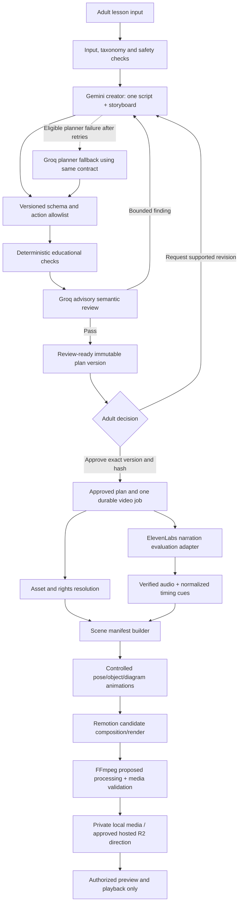
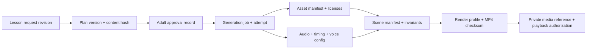

# Generation Pipeline and Provider Abstraction — Edupilo / AI Educational Story Video Platform (V1)

**Status:** Proposed implementation-oriented design for review; **not an implementation or provider approval**  
**Prepared:** 11 November 2026  
**Authority:** `docs/PRD.md` defines product scope; `docs/DECISIONS.md` defines row-level approvals; `AGENTS.md` defines engineering guardrails. Supporting references: `docs/TECHNICAL_DESIGN.md`, `docs/SYSTEM_DESIGN.md`, `docs/POC_EXECUTION_PLAN.md`, `docs/DATABASE_DESIGN.md`, and `docs/API_DESIGN.md`. This file is the canonical AI/media pipeline contract.

> **Scope reconciliation (updated 11 November 2026):** V1 uses **premium cinematic 2.5D animation with layered 3D-style artwork**, authorized playback, and no user-facing MP4 download. Genuine provider-generated 3D/video remains a separately gated future adapter because the founder selected a ₹0-first implementation. Static pan/zoom does not qualify as animation.

> **Evidence limitation:** The supplied `PROJECT_STATUS.md` is dated 10 November and says the repository was documentation-only. Subsequent conversation shows a working `web/` Next.js dev-server command and a root Remotion POC manifest. **Neither proves** complete Gemini/Groq/ElevenLabs integration or an accepted bilingual video. Actual code, assets, output, and measurements must be inspected before implementation or any completion claim.

## 1. Purpose and acceptance boundary

The system lets an **adult parent or teacher** request an age-appropriate, bilingual (English/Hindi) animated educational story for Nursery/KG–Class 4. A creator generates **one cohesive script and storyboard**. Structured validation, an advisory semantic reviewer, and an **explicit adult review** protect educational accuracy. Approved narration, reusable illustrated characters, structured educational facts, and controlled on-screen motion become an internally stored MP4 for protected playback.

**The expected video is animated educational storytelling, not a lecture or slideshow.** The rabbit must react or change pose as carrots move into baskets; grouping and equation reveals must teach the concept. Merely zooming across a flat illustration does not prove expressive character/object animation. Remotion is a **programmable animation/composition/rendering candidate**, **not** an AI text-to-video/3D animation model.

### 1.1 Source-aligned decision table

| Capability | Current status | Consequence |
|---|---|---|
| Gemini creates initial script **and** storyboard together | Approved Phase 0 direction (`TECH-001`, `TECH-003`) | Exact model/config and production approval pending |
| Groq-hosted open model reviews and serves as conditional planner fallback | Approved Phase 0 direction (`TECH-002`) | Model, rubric, bounded retries, quota and privacy to test |
| Deterministic educational counts/equations | Approved (`TECH-004`) | Programmatic, non-negotiable for supported math |
| Reusable layered 3D-style PNG/SVG + cinematic 2.5D concept animation | Approved product direction (`PROD-006`) | Character/style consistency and actual educational motion required |
| ElevenLabs TTS | Approved **internal Phase 0 evaluation** (`TECH-006`) | Exact voice/model, privacy, usage and commercial rights **not** approved; Azure superseded (`TECH-005`) |
| Explicit adult approval of a precise plan version | Agreed functional requirement; final safety checklist still inconsistent (`PROD-007`, `OPS-001`, `INC-003`) | **Never allow bypass**; reconcile formal approval before full implementation |
| Next.js/TypeScript, metadata database, separate worker | Proposed (`TECH-007`–`TECH-011`) | Architecture sketch only; no implied production go-ahead |
| Remotion and FFmpeg | Candidate/proposed (`TECH-012`, `TECH-014`) | License/codec compliance and feasibility tests required |
| Cloudflare R2 hosted media | Approved direction (`TECH-015`) | Private access and lifecycle configuration pending; local media suitable for POC |
| Native 1080p final, ratio, FPS | Pending/undecided (`PROD-010`–`012`) | Explicit test profile only until approved |
| External generated-motion provider / true 3D scene generation | **Not selected for V1**; cinematic generation deferred (`PROD-017`) | Requires a scoped PRD, budget, safety, license and technical approval |
| Public MP4 download | **Deferred** (`PROD-016`) | Internal MP4 exists for protected playback; no download endpoint/UI |

## 2. End-to-end pipeline and human gates



**Hard boundaries:**

1. No narration, paid/expensive media generation, or final render from a plan that has not passed validation and received adult approval.
2. AI responses provide **untrusted, structured data**, never executable JSX, shell commands, SVG scripts, file paths, URLs, or arbitrary animation code.
3. Educational facts come from typed data and deterministic checks, not an LLM's confidence or a generated image's apparent item count.
4. Audio timing becomes authoritative **after** TTS. Estimated storyboard lengths are not promises of final duration.
5. Fail visibly on wrong language, incorrect math, missing/unauthorized assets, corrupt media, or inadequate quality; do not silently swap providers, languages, scenes, or output profile.
6. Each external request and render has an idempotency/caching boundary, retries are bounded, and successful artifacts survive downstream failure.

## 3. Contracts and canonical artifacts

The examples below are **proposed minimal interface shapes**, not final approved schemas or code already implemented. The versioned structured plan in `docs/TECHNICAL_DESIGN.md` §2.2 remains the baseline; `docs/DATABASE_DESIGN.md` owns persistence; `docs/API_DESIGN.md` owns public HTTP contracts. Concrete JSON schema and supported action list require a separately authorized implementation task.

### 3.1 Artifact and validation matrix

| Stage | Input | Output | Mandatory validation / failure behavior |
|---|---|---|---|
| Input normalization | Adult class, topic, subject, locale, instruction, optional non-personal context | `LessonRequest` + canonical input hash | Adult identity/ownership where applicable; selected taxonomy; bounded/sanitized text; privacy/sensitive-topic policy |
| Script + storyboard planning | Valid lesson, supported asset/action vocabulary, schema/rubric | `StructuredPlan` containing `lesson`, `story`, `scenes`, version, proposed facts/actions/cues | Parse strict JSON; reject unknown schema/version/scene/action; no prose-as-JSON workaround |
| Deterministic checks | Structured scene facts and actions | `MathValidation` + educational fact manifest | Recompute quantities, displayed groups, and equations; reject mismatches |
| Groq review | Valid normalized plan + age/language/safety rubric | Structured findings and pass/revise/escalate recommendation | Findings are advisory; reject malformed reviewer response; never overwrite approved plan |
| Adult review | Versioned plan, explanations, flags, semantic findings | Immutable approval record or scoped revision request | Check exact version/hash; authorization; explicit action; no inferred approval |
| Asset resolution | Approved plan + known logical asset IDs | `AssetManifest` (poses, layers, checksums, rights and private references) | Only approved/licensed assets; reject missing capability, untrusted SVG or inconsistent style |
| TTS synthesis | Approved scene narration + locale + voice/model/config | Audio file + provider timing response + usage | Validate locale, voice, coverage, non-empty audio, duration, clipping and pronunciation review |
| Timing normalization | Audio, text, char/word stamps | `NormalizedTiming` of word/phrase/scene cues in ms | Monotonic timestamps, text coverage, within-audio bounds, Devanagari segmentation, no fabricated precision |
| Scene assembly | Approved plan + assets + timing + deterministic facts | `SceneManifest` with templates, actions, frames, safe areas, captions | No unknown actions/assets; all numeric invariants; no collisions/timing overrun |
| Composition/render | Scene manifest + approved test/final profile | Rendered MP4 and render metrics | Quality profile, dimensions, frame count, missing frames and render health |
| Processing/inspection | MP4 + expected media properties | Validated media metadata, checksum and failure report | Expected audio/video streams, codec, fps, duration, sync, no corrupt output |
| Storage/playback | Validated media + owner/job references | Private media reference + protected playback entitlement | Storage checksum, owner authorization, short-lived access, no download action |

### 3.2 Lesson input — proposal

```json
{
  "learnerLevel": "CLASS_2",
  "subjectKey": "MATH",
  "topicKey": "MULTIPLICATION_EQUAL_GROUPS",
  "language": "en-IN",
  "instruction": "Explain multiplication through a rabbit placing carrots in baskets.",
  "preferredContext": { "characterKey": "character.rabbit.ria" }
}
```

These topic/character keys are **illustrative POC candidates**, **not** an approved initial taxonomy. `hi-IN` and `en-IN` are the proposed normalized locales. Do not request a child's full name, birthdate, school, photo, voice, or location.

### 3.3 Unified plan (script and storyboard are inseparable)

Proposed core structure based on the technical design:

```json
{
  "schemaVersion": "1.0",
  "lesson": {
    "objective": "Understand multiplication as equal groups",
    "learnerLevel": "CLASS_2",
    "language": "en-IN",
    "title": "Ria Rabbit Counts Carrots"
  },
  "story": { "premise": "Ria shares carrots equally among baskets" },
  "scenes": [
    {
      "sceneId": "scene-03",
      "learningPurpose": "Make three equal groups of two visible",
      "narration": "There are three baskets with two carrots in each basket.",
      "visualIntent": "Show three baskets and place exactly two carrots in each",
      "assets": ["character.rabbit.ria", "object.basket", "object.carrot"],
      "facts": {
        "groups": 3,
        "itemsPerGroup": 2,
        "total": 6,
        "equation": "3 × 2 = 6"
      },
      "actions": [
        { "type": "REVEAL_GROUPS", "count": 3 },
        { "type": "DISTRIBUTE_ITEMS", "itemsPerGroup": 2 },
        { "type": "SHOW_LABEL", "textRef": "equation" }
      ],
      "captionCues": ["three baskets", "two carrots in each"],
      "estimatedDurationMs": 9000,
      "reviewFlags": []
    }
  ],
  "safetyFlags": [],
  "factualReviewRequired": true
}
```

**Example limitation:** This is a single illustrative scene, not the entire five-scene lesson. The example is not approval for the exact story, model, scene action vocabulary, or duration. Later narration and captions must come from the **approved plan version**.

### 3.4 Immutable approval boundary and lineage

For a proposed `videoPlans` version, preserve:

- `schemaVersion`, `version`, `lessonRequestId`, `ownerId`, canonical structured content and `contentHash`.
- Creator model/config revision; Groq reviewer findings; deterministic, safety and language validation results.
- `status`, `approvedBy`, `approvedAt`; approvals are only valid for the exact reviewed hash.
- Any content-changing revision creates a **new version** and invalidates reuse of prior content approval for that new version.
- The approval HTTP operation and `VIDEO_GENERATION` job creation are **atomic/idempotent** per `docs/API_DESIGN.md` §4.9; repeated click does not create duplicate billable work.

## 4. Replaceable provider boundaries

Use validated, narrow adapters. Do not import provider SDK response types into shared domain models. These are **responsibility contracts**, not automatic authorization to install or call a provider.

| Adapter | Core methods / responsibilities (proposed) | Provider-specific isolation |
|---|---|---|
| `CreatorAdapter` | `generatePlan(request, schema, availableCapabilities, config)` → structured candidate + token/latency usage | Gemini model, response format, generation settings, retries |
| `ReviewerAdapter` | `reviewPlan(plan, rubric, config)` → structured severity/scene findings | Groq model, thresholds, completion format |
| `PlannerFallbackAdapter` | Conditional `generatePlan` with **same** schema | Groq fallback must be independently validated; not used on every normal request |
| `TTSAdapter` | `synthesize(approvedText, locale, voiceId, settings)` → audio + raw alignment + usage | ElevenLabs endpoint/model/voice; no silent language replacement |
| `TimingNormalizer` | `normalize(rawAlignment, text, audioDuration)` → stable ms cues | Keeps raw provider timestamps out of animation templates |
| `AssetCatalogAdapter` | Resolve logical IDs to approved layers, poses, checksums and licensed media | Filesystem locally; storage backend later; rights verified |
| `SceneCompiler` | Build deterministic object layouts and allowlisted motion actions from a scene plan | No provider-specific inference during render |
| `RendererAdapter` | `render(sceneManifest, profile)` → media + metrics | Remotion candidate initially; Motion Canvas fallback only if approved |
| `MediaProcessor` | Inspect/normalize/encode/verify audio-video streams | FFmpeg tool/build flags, codec support and license obligations |
| `MediaStoreAdapter` | Private `put/getHead/delete` by approved lifecycle policy | Local filesystem for POC; R2 hosted direction once configured |
| `MotionGenerationAdapter` | **Not part of currently selected V1**; potential shot provider after formal change approval | Must not be invoked or substituted while unapproved |

### 4.1 Provider configuration and secrets

- Pin model/voice IDs, versions, temperatures, rate limits, supported locales, timeout policy, and feature flags in validated **server/worker configuration**; do not hard-code quotas, prices or eligibility.
- Store keys only in protected server/worker environment configuration. Never expose API keys in client code, logs, generated media, plan records, sample screenshots, or repository files.
- Return structured domain errors: `SCHEMA_INVALID`, `AGE_REVIEW_REQUIRED`, `MATH_MISMATCH`, `VOICE_LANGUAGE_UNSUPPORTED`, `RATE_LIMITED`, `ASSET_NOT_APPROVED`, `RENDER_FAILED`, `MEDIA_INVALID`, etc. (illustrative, not a finalized error-code enum).
- Capture sanitized provider request ID, model/voice, duration, tokens/characters, attempts, retry classification, and cost estimate; avoid routine logging of raw adult lesson text.
- No automatic provider fallback to a service whose terms, privacy, or cost have not been approved. Never call a paid tier without separate founder authorization.

## 5. Stage policies, validations, and failure conditions

### 5.1 Pre-planning: input, learner level and safety

- Require a supported class/age band, subject/topic, locale and bounded instruction; reject unsupported values instead of inventing a curriculum.
- Sanitize for display and model instructions. Distinguish user text from trusted system/schema instructions to reduce prompt injection.
- Only send the minimum necessary non-personal context to external providers. Do not accept arbitrary uploads or child photographs while those features remain unapproved.
- Any undecided sensitive-topic policy is a **blocker to broad public use**; an AI reviewer is not a substitute for an approved product safety policy.

### 5.2 Script/storyboard creation — Gemini first

- One creator response produces the script and corresponding scene descriptions **together**, so narration, visual intent, props, numeric facts, actions and captions are coherent.
- Require exact schema/version and valid action/asset identifiers. Reject unsupported shot types, fabricated assets and executable code.
- Every scene needs a learning purpose, narration, visual intent, cited structured facts where relevant, and estimated duration.
- Store the candidate version only after parsing, schema and deterministic checks; do not prematurely label it `REVIEW_READY`.
- Gemini retries only on classified transient errors. If configured bounds are reached, invoke **only the independently evaluated Groq fallback** using the same normalized contract, and record why.

### 5.3 Deterministic education engine

For the rabbit test:

- `groups = 3`; `itemsPerGroup = 2`; `total = 3 × 2 = 6`.
- Generate exactly **three** basket instances.
- Generate exactly **two** carrot instances per basket, **six** visible carrots in total.
- Repeated addition: `2 + 2 + 2 = 6`; multiplication: `3 × 2 = 6`.
- All counts/equations should derive from typed facts, never an LLM's display string or a generated illustration with approximate carrot numbers.
- Validate both the scene plan and the render manifest's object-instance counts, keyed groups and equation labels. Reject wrong or contradictory actions.

A deterministic validator cannot establish all non-mathematical factual correctness. Other subjects will require topic-specific invariants and human/factual review after the transfer topic is approved.

### 5.4 Groq semantic review — advisory, not approval

Proposed structured finding: `{ severity, sceneId, rule, explanation, suggestedConstraint }`. Evaluate:

- Vocabulary, sentence structure, pacing and story complexity for learner level.
- Cross-scene factual consistency, continuity, language correctness and continuity of character/props.
- Narration–visual agreement and whether every animation supports a learning goal.
- Caption density, sensitive topics, unsupported actions, and likely misconceptions.

A hard deterministic math failure blocks progression regardless of a Groq "pass." A Groq reviewer failure, disagreement or severe finding should return the plan for a bounded correction or adult attention; never imply an LLM can certify educational truth. The exact rubric, thresholds and failure behavior require tests/approval.

### 5.5 Adult review — planned non-bypassable gate

Present the **script and per-scene storyboard side by side or in one combined review experience**, including facts, actions, narration and flagged issues. The adult may approve an exact version/hash or request a scoped revision. Preserve prior versions.

**Enforced invariant:** `VIDEO_GENERATION` must reference an approved immutable plan; expensive synthesis/rendering cannot be started from a `DRAFT`, `GENERATING`, `INVALID`, `REVIEW_READY` (unapproved), or superseded plan. This is the intended P0 safety design even though `OPS-001` final signoff is still open; reconcile the checklist before expanding implementation.

### 5.6 Licensed visual assets and character consistency

- Use a character **sheet** with a fixed style palette, proportions, anchor points, layering order, facial expressions, and named poses (e.g., idle, look, point, celebrate).
- A layered SVG lets arms/eyes/mouth/props move as needed; a flat raster image cannot be treated as an articulatable rig without additional artwork.
- Props, backgrounds, fonts and sound effects must have stable logical IDs, version, source, checksum, usage-rights evidence and approved-use status.
- Prefer project-owned layered SVG/PNG and procedural diagrams. Important educational words, numbers and labels are drawn programmatically, not embedded in AI illustration pixels.
- Only approved/licensed assets may enter a final render. An unsupported pose/action results in a visible failure or a separately reviewed asset substitution; never silently animate nonexistent limbs or invent misleading object counts.
- The chosen asset family/style must remain consistent across scene cuts and languages. Provide visual continuity: same rabbit scale/proportions and palette, consistent basket/carrot design, matching shadows/line weight.

### 5.7 Bilingual narration — ElevenLabs internal evaluation only

- ElevenLabs replaces Azure as the **active Phase 0 evaluation direction**; no Azure calls unless separately reauthorized.
- Verify that the selected **exact** model and voice support `en-IN`/`hi-IN` input acceptably; published multilingual support does not prove every voice is suitable.
- Generate audio only from **approved narration**; normalize numbers and equations to natural speech for the selected locale (e.g., spoken "three groups of two" rather than reading mathematical punctuation mechanically).
- Test Hindi pronunciation, Devanagari normalization, code-switching, numerals, classroom vocabulary, intonation, pacing and expressive storytelling with fluent listeners.
- Request official timestamped TTS data if supported by the evaluated endpoint. Preserve raw alignment for diagnostics, normalize to millisecond word/phrase cues, and verify coverage against the actual approved text.
- Reject empty, wrong-language, incomplete, clipped or corrupted audio. If alignment is missing/incorrect, hold for a separately approved alignment fallback rather than guessing.
- Cache reusable audio by approved plan/scene content + provider + model + voice + locale + synthesis settings + normalization version; record credits/usage and prevent duplicated calls.
- The free plan is for **internal evaluation only**, not authorization for commercial outputs; current published limits and terms must be reverified before use.

### 5.8 Audio-to-animation synchronization

**Authoritative clock:** measured synthesized audio, not the storyboard estimate. Create a normalized timeline with scene start/end, word/phrase boundaries, action cues, planned reading/understanding holds and caption intervals.

| Timing trigger | Expected action | Validation |
|---|---|---|
| Rabbit introduces the problem | Rabbit changes from idle to speaking/gesturing pose; title appears | No arbitrary unrelated camera-only motion |
| "Three baskets" | Reveal exactly 3 baskets in a countable layout | All three visible, unoccluded and within safe area |
| "Two carrots each" | Animate 2 carrots into **each** basket, using the typed group layout | Total exactly 6; no extra prop carrots counted |
| "Two plus two plus two" | Highlight each group, then reveal `2 + 2 + 2 = 6` | Equation and visible groups correspond |
| "Three times two" | Show `3 × 2 = 6`, hold for comprehension | Caption aligns with speech; positive hold and readable glyphs |
| Narration ends | Allow a brief comprehension hold, then transition | Never clip final spoken word or on-screen result |

If timestamps are character-level, conversion to words/phrases must handle Unicode and Hindi combining marks without breaking graphemes. Store start/end in integer milliseconds; make all intervals nonnegative and ordered. Alignment confidence and acceptable visual lag must be empirically measured in the POC rather than claimed as a fabricated tolerance.

**Caption density:** Nursery/KG minimal keyword labels; Classes 1–4 short timed phrases. Test font glyph support for English and Devanagari; avoid captions obscuring baskets, carrots, character faces or equations.

### 5.9 Scene manifests, controlled motion and Remotion

Example **proposed** compiled scene fragment, derived only from approved data:

```json
{
  "planVersion": 1,
  "planContentHash": "sha256:example-not-a-real-hash",
  "sceneId": "scene-03",
  "profileId": "POC_16_9_1080P_30FPS_TEST_ONLY",
  "facts": { "groups": 3, "itemsPerGroup": 2, "total": 6 },
  "resolvedAssets": [
    { "logicalKey": "character.rabbit.ria", "version": 1, "pose": "point" },
    { "logicalKey": "object.basket", "version": 1 },
    { "logicalKey": "object.carrot", "version": 1 }
  ],
  "actions": [
    { "type": "REVEAL_GROUPS", "atMs": 700, "count": 3 },
    { "type": "DISTRIBUTE_ITEMS", "atMs": 2100, "groups": 3, "itemsPerGroup": 2 },
    { "type": "SHOW_LABEL", "atMs": 5700, "textRef": "equation" }
  ],
  "audioRef": "private://example/audio/scene-03",
  "sceneDurationMs": 9000
}
```

**Caveats:** The profile string, timings, pose ID and media URI above are **illustrative test data**, not production-approved values or existing artifacts. Real manifests also require audio duration, checksums, safe areas, caption cues, transition rules and validation status; preserve actual scene facts even when timings change.

- Prefer meaningful pose/expression changes, controlled limb/prop motion where artwork supports it, carrot translation/rotation into groups, reaction gestures, character staging, diagram highlights and intentional transitions.
- Use camera pan/zoom only to support action and focus. **Camera movement applied to a motionless image is not equivalent to expressive animated character action.**
- Enforce bounded composition dimensions, layer order, typography safe areas, scene action allowlists and storyboard fact invariants before render.
- Remotion owns timeline/reactive frame animation and rendering; FFmpeg can inspect, normalize, encode/mux or compose as the specific validated pipeline requires. Neither should invent a new lesson from storyboard prose.
- **Visuals must be reviewed in playback**: an MP4 that technically renders but looks like a slideshow, uses expressionless figures or fails to demonstrate the concept does not pass quality acceptance.

### 5.10 Media processing, final validation and playback

- For the POC, use local private MP4 files. For hosted deployment, Cloudflare R2 is the approved direction; bucket setup, signed access, retention, cost and deletions are pending.
- Drafts may use a lower profile **only if labeled as drafts**; the proposed production bar is **native 1080p**, pending formal signoff. Test profile ratio (16:9 vs 9:16) and FPS (24/30) are explicitly experimental.
- Inspect decoded streams and media metadata with FFprobe/FFmpeg: resolution, fps, audio and video codecs, sample rate, durations, missing streams, truncation and integrity. Check real visual/audio synchronization by listening and watching the rendered video.
- Record checksum, media size, render profile, elapsed render time, peak memory and observed quality defects. Do not mark video `READY` unless the intended checks pass.
- Only return owner-authorized playback/short-lived access. **Do not add user-facing MP4 download, permanent public URLs, or default `Content-Disposition: attachment`.**

## 6. Reliable execution: jobs, checkpoints and retries

**Proposed runtime:** One separate Node.js/TypeScript worker processing one heavy video job at a time on the 8 GB Windows machine. The Next.js API performs short authentication/authorization/status operations, not long-running TTS/rendering. Database selection and worker implementation remain unapproved.

### 6.1 Durable stage and state model

- Machine states: `QUEUED → CLAIMED → RUNNING → SUCCEEDED`; retryable failure `RUNNING → WAITING_RETRY → QUEUED`; permanent failure `RUNNING → FAILED`; safe cancellation `CANCEL_REQUESTED → CANCELLED`.
- User-visible stages: `PLANNING`, `SEMANTIC_REVIEW`, `ASSET_RESOLUTION`, `NARRATION`, `TIMING`, `COMPOSITION`, `RENDERING`, `POST_PROCESSING`, `STORAGE`, `VALIDATION`.
- Expose named stages, timestamps and actionable errors; do not invent a progress percentage.
- A job claim uses an exclusive lease, heartbeat and stale-recovery path. Persist stage checkpoints before moving to the next stage; never mark partial/corrupt output ready.

### 6.2 Checkpoint contents — proposal

Every stage/attempt should record: owner-safe job ID, stage/state, exact approved plan ID/hash, schema/model/voice/config version, input hash, attempts, provider usage/latency, artifact private references/checksums, validation summary and next safe checkpoint. Use sanitized failure codes and retryability classification; exclude secrets and unnecessary raw child-related input.

### 6.3 Retry and fallback rules

| Failure | Retry policy | Safe invariant |
|---|---|---|
| Gemini temporary timeout/429/5xx | Bounded provider retry; Groq planner fallback only after configured exhaustion and evaluation | Same planning schema and validation; never skip adult approval |
| Gemini malformed schema or invalid facts | Bounded schema-aware correction; then stop/conditional approved fallback | Do not pass bad scenes to review/render |
| Groq reviewer timeout or disagreement | Retry within bounds or escalate for review | No fabricated "review passed" |
| TTS quota/rate-limit | Honor `Retry-After`, bounded backoff; show quota failure | No accidental duplicate charge or wrong-language fallback |
| TTS returns no timing | Stop or use independently approved tested alignment procedure | Never fake accurate synchronization |
| Missing/unlicensed visual asset | Stop, return for review, or request approved replacement | No fabricated counts/unlicensed art |
| Render crash or high RAM | Reuse successful upstream checkpoints; safe single-job re-render | No automatic final-resolution degradation |
| FFmpeg detects invalid streams or corrupt MP4 | Reject final, preserve prior valid output, stage-specific retry if safe | No invalid media served as `READY` |
| Billing/cost cap reached | Stop and request explicit approval | No automatic paid upgrade |
| Adult requests cancellation | Finish/interrupt only at safe checkpoint | Preserve approved plan and last valid video |

Retries must not unexpectedly create additional provider calls when cached successful artifacts remain valid. An idempotency key for video generation should include owner, approved plan hash/version and render profile; a stage cache key also includes provider, exact model/voice/settings and input version.

## 7. Reproducibility, provenance, caching and storage

### 7.1 Artifact lineage



Reproducibility means retaining the structured plan, model/voice/config revisions, deterministic layout algorithm version, ordered asset IDs/checksums, audio/timing hashes and renderer/encoder profile. A re-run of a nondeterministic LLM is **not** guaranteed identical; reproduce by using the stored approved plan/artifacts whenever retention permits.

### 7.2 Caching strategy

| Artifact | Safe cache identity | Invalidation event |
|---|---|---|
| Planned output | Normalized lesson input + schema version + creator model/config + capability list | Input/locale/topic/model/schema changes |
| Approved plan | Immutable plan version + canonical content hash + adult approval | New version requires new approval |
| Asset manifest | Approved asset logical ID/version/checksum + style family + licensing state | Asset changed, retired or rights withdrawn |
| Narration audio | Approved normalized text + provider/model/voice/locale/settings + normalization revision | Text, voice, model, timing behavior or settings change |
| Timing cues | Audio checksum + raw alignment or aligner version | Audio or alignment model changed |
| Scene manifest | Approved plan hash + asset hashes + timing hashes + compiler version | Any approved scene/asset/timing change |
| Render | Scene manifest hash + render profile + renderer/codec versions | Scene/profile/tool version change |

Do not share private user artifacts across accounts without an approved access/consent policy. The database stores **metadata and private references only**; no large audio/video/frame binaries. Retention and deletion policies remain open, so cache eviction is **not** a silent legal/privacy decision.

### 7.3 Usage, limits and privacy

Record per request: provider, model/voice identifier, input/output tokens or narration characters, request count, retry/attempt number, billed or estimated credits, pricing snapshot version, request latency, cache hit and error status. Costs are estimates until reconciled with provider usage.

- Support a configured development spend cap or free-tier boundary; any paid enablement requires explicit approval.
- Re-check current quotas, country/language availability, fair-use terms and commercial rights before adopting any provider; never claim free tiers are unlimited.
- Do not send a child's full identity, image, voice or precise location to providers. Keep keys and raw sensitive payloads out of telemetry, browser bundles and media.
- License/provenance evidence must cover fonts, characters, backgrounds, sound, music, TTS voices, Remotion eligibility, FFmpeg build/codec and any future motion-generation provider.

## 8. External motion-generation / 3D: separate change-proposal track

Genuine video-generation or true-3D providers are a **future optional upgrade**, because the active PRD prioritizes a ₹0-first cinematic 2.5D pipeline using 3D-style layered artwork. Do **not** implement or assume any provider, hosted GPU, scene-generation API or paid budget in V1.

If the founder later **authorizes a limited motion-provider experiment**, test it in isolation rather than embedding it in the V1 renderer path. Proposed questions:

1. Does the provider create **genuine subject motion** (e.g., the rabbit's arms/body move or carrots are placed), not a still with camera zoom, parallax or transition?
2. Can one character retain a consistent face, colors, clothing and proportions across at least two shots?
3. Can the generated shot coexist with **deterministically rendered** baskets/carrot counts and equation overlays, without confusing extra carrots or wrong amounts?
4. Can the scene be aligned with approved English and Hindi voice timing without visually contradicting the narration?
5. Are the output, duration, resolution, rerender cost, retention, API automation, privacy and commercial rights workable under an **explicitly approved** spend ceiling?
6. Does it add enough teaching/visual value to justify changing the PRD compared with fully controlled layered assets?

**Suggested 3D-motion experiment rubric — proposal only, not a V1 acceptance criterion:** visibly articulated character movement; spatial continuity and no body distortion; consistent visual identity across shots; demonstrable carrot handoff/placement; accurate educational overlays when composited; bilingual sync; no copyright/privacy concerns; independently measured provider success, failures, latency and cost. A 2D expressive puppet animation may satisfy the current PRD without any 3D provider.

**Remotion's role if such a change is approved:** sequence approved genuine-motion clips, narration, sound, captions, deterministic math overlays and final output. It would still **not** synthesize the 3D motion itself. A provider could supply motion video, but the approved structured lesson facts must remain authoritative and be composited/validated separately.

## 9. Proposed Phase 0 verification and exit evidence

The source `docs/POC_EXECUTION_PLAN.md` stages are a **proposed plan** and still contain outdated Azure mentions. `TECH-006` selects ElevenLabs for **internal narration evaluation only**; do not silently rewrite historical plan text or revive Azure. POC execution, specific profiles and commercial licensing remain subject to their approval gates.

### 9.1 First lesson: rabbit, baskets and carrots

| Scene | Required educational behavior | Observable proof |
|---|---|---|
| 1. Introduce | Rabbit moves/gestures and introduces equal grouping | Same identifiable rabbit, age-appropriate language |
| 2. Reveal groups | Precisely three baskets enter and settle | Exactly three groups, readable/uncrowded layout |
| 3. Distribute carrots | Two carrots placed into each basket with synchronized count cues | Exactly six, grouped 2+2+2; no phantom carrots |
| 4. Repeated addition | Group highlights and `2 + 2 + 2 = 6` | Narration, visible groups and expression agree |
| 5. Multiplication/recap | `3 × 2 = 6`, character celebrates or points | Learner has comprehension hold before scene end |

English and Hindi runs need separately approved plans/phrasing, while their **math invariant remains identical**. A second different approved topic must reuse contracts/templates without rewriting the platform to establish transferability.

### 9.2 Human review versus automated checks

| Dimension | Automated evidence | Human evaluation |
|---|---|---|
| Structured plan | Schema/action/asset references, version and hash | Story coherence, pedagogical usefulness |
| Math | Correct group/object/equation invariants | Does the explanation avoid misconceptions? |
| Age/language | Locale fields, text bounds, reviewer findings | Fluency, Hindi numerals, pronunciation, clarity |
| Character | Consistent asset IDs, pose definitions, style family | Appearance and expressive animation quality |
| Alignment | Cue ordering, caption bounds, audio coverage | Do visible actions correspond to spoken concepts? |
| Media | File decode, streams, profile, duration, checksum | Visual polish, absence of slideshow-like shots or clipping |
| Reliability | Retry/cancel checkpoints, attempt counters | Understandable errors and safe recovery |
| Costs/rights | Request/credit logs, rights metadata | Quota acceptability and licensing signoff |

**No invented thresholds:** acceptable sync lag, minimum expressive-motion criterion, pass rate, output quality, resource ceiling, number of POC samples and renderer configuration require experiment evidence and approval. Record actual observations instead of declaring success merely because a video rendered.

### 9.3 Minimal evidence report

```text
POC experiment: <approved lesson and date>
Approved plan IDs/hashes: <English / Hindi>
Creator / reviewer models and revisions: <exact IDs>
TTS provider, exact voices and timestamp method: <measured>
Asset sheet/style/licenses/versions: <verified>
Renderer/FFmpeg versions, codec/build/license notes: <verified>
Test profile (ratio, dimensions, fps): <explicitly test-only>
Math/object-count checks: <pass/fail + observations>
English/Hindi human listening results: <observed>
Character motion / continuity assessment: <observed>
Caption/action-to-voice alignment: <observed>
Duration, output size, peak RAM, render time: <measured>
Provider calls/credits/cost estimates: <measured>
Failures, retries, unresolved safety/right issues: <recorded>
Transfer topic results: <if approved and executed>
Recommendation: GO / CHANGE / STOP (not automatic production approval)
```

## 10. Proposed sequencing and handoff

1. **Inspect current code and media evidence**: confirm what actually exists in root Remotion POC, `web/`, scripts, assets, tests and narration files. Reconcile the stale 10 November `PROJECT_STATUS.md` factual implementation snapshot; do **not** change founder decision statuses by inference.
2. **Resolve narrow experiment approvals**: POC lesson and success rubric, adult gate, test profile, provider/privacy terms, Remotion/FFmpeg evaluation and any external service access. Avoid paid activation.
3. **Verify contracts and educational invariants** with fixed bilingual fixtures. Correct invalid facts/actions before media work.
4. **Inspect expressive character/object animation** in a local rendered scene; do not equate camera motion with animated storytelling.
5. **Evaluate ElevenLabs English/Hindi audio + timestamps** within the authorized internal free tier; listen, align, cache and record usage.
6. **Integrate approved POC stages** after adult approval; render and inspect final-quality output only under an approved POC test profile.
7. **Run a separately approved transfer-topic test**, measure reliability/cost/quality and produce an evidence-based GO / CHANGE / STOP recommendation.
8. **Only then** seek separate production approval for auth, database, durable worker deployment, R2 lifecycle, full MVP scope, exact AI providers and commercial media rights.

### Cross-document conflicts to carry into review

- `docs/POC_EXECUTION_PLAN.md` still describes Azure in its candidate evaluation steps; `DECISIONS.md` `TECH-005/006` supersedes that direction with ElevenLabs for internal Phase 0 evaluation.
- Existing Mermaid diagrams in `docs/SYSTEM_DESIGN.md` and `docs/TECHNICAL_DESIGN.md` name the ElevenLabs TTS node but retain an obsolete `WORKER --> AZURE` edge; this is a diagram error, **not** a reinstated provider decision.
- `PROJECT_STATUS.md`/`README.md` (10 November) say no implementation exists; later development logs suggest some code exists. Only actual repository inspection can establish verified status.
- The separate prompt pack implies external generative shot production, 3D animation, user uploads and user MP4 download; those would **expand or contradict** the existing V1 PRD and require a deliberate product decision and updated source documents.
- Exact initial supported topics, production output profile, authentication, media retention, approved legal/commercial rights and production deployment are still pending; this document does not resolve them.

---

**Design verdict:** The smallest coherent current pipeline is **Gemini joint script/storyboard → schema/math/Groq review → explicit adult approval → layered 3D-style asset resolution + ElevenLabs narration/timing evaluation → cinematic 2.5D character/object animation → Remotion candidate → FFmpeg validation → private authorized playback**. This is a documented *design and test direction*, **not** proof of production readiness. A third-party true-3D/text-to-video provider is unnecessary unless a separate, evidence-backed product change is approved.
