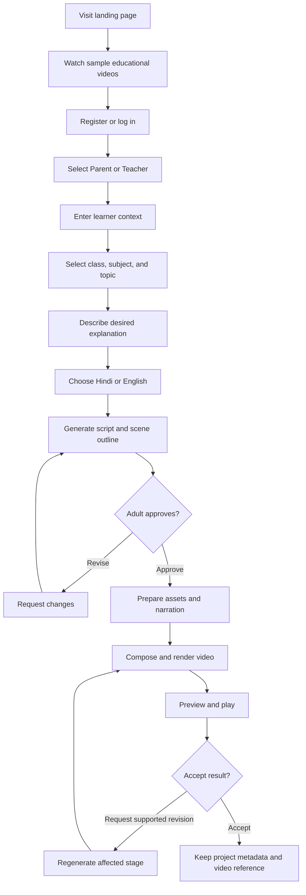
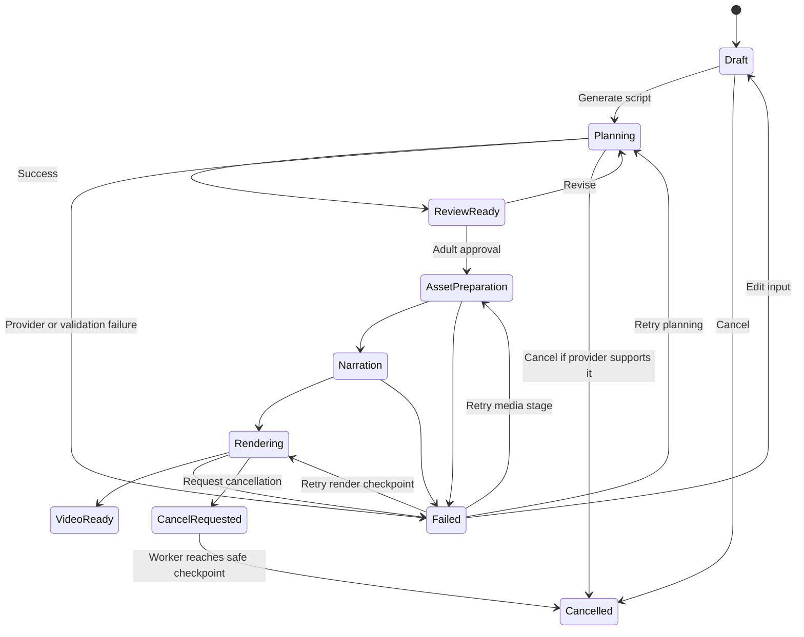
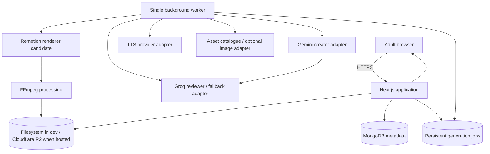

# Product Requirements Document

## AI Educational Story Video Platform — V1

**Status: Active Draft — Core Product and Visual Direction Confirmed; Remaining Operational Decisions Open**

## 1. Document Information and Approval Status

| Field | Value |
|---|---|
| Status | **Active Draft — core product and visual direction confirmed on 11 November 2026** |
| Date | 10 November 2026 |
| Working name | AI Educational Story Video Platform |
| Product category | AI-assisted educational storytelling and animated video creation |
| Primary operators | Parents and teachers |
| Target learners | Nursery, kindergarten, and Classes 1–4 |
| Initial languages | Hindi and English — approved V1 direction |
| Document purpose | Define a realistic, testable V1 before technical design and implementation |
| Source of truth | Requirements supplied by the founder on 10 November 2026 |

### Approval legend

| Label | Meaning |
|---|---|
| Agreed direction | Explicitly included in the supplied product direction |
| Proposed | Recommended for V1 but requires founder confirmation |
| Open decision | Must be decided before the stated implementation stage |
| Deferred | Explicitly outside V1 |

### Previous-PRD conflicts

The previous PRD is preserved in `docs/PRD.previous.md`. The new requirements represent a material product pivot rather than a minor revision.

| Previous PRD | Current product direction | Resolution in this draft |
|---|---|---|
| Broad creators, educators, experts, and brands | Parents and teachers creating for young children | Current parent/teacher direction treated as primary; pending founder approval of this pivot |
| General educational motion-graphics explainers | Cartoon educational stories plus concept-based animation | Replaced by hybrid illustrated storytelling direction |
| Initial launch language English | Hindi and English in V1 | Hindi and English included as proposed V1; voice quality must pass evaluation |
| Gemini and ElevenLabs as earlier defaults | Gemini remains the Phase 0 planner; ElevenLabs replaced Azure AI Speech as the internal Phase 0 narration evaluation default on 11 November 2026 | Providers remain replaceable through adapters; production/commercial TTS remains unapproved |
| Motion Canvas considered for rendering | Remotion is the primary candidate | Remotion evaluated first, subject to licensing and feasibility review |
| Earlier Next.js/PostgreSQL discussion and later React/Vite/Express proposal | Next.js full-stack application plus a separate background worker | Updated after the founder clarified the preference for one full-stack framework |
| Vertical 1080p MP4 download included | Playback is required; user download is excluded from V1 | Download deferred; final media remains available through authorized playback subject to retention policy |
| Instagram publishing considered later | Social publishing is not part of the child-learning direction | Removed from committed roadmap |
| 30–120 second duration ceiling | Duration follows the approved lesson and learner comprehension needs | POC defines warnings and split guidance, not a forced preset |

No previous decision is silently carried forward where it conflicts with the current direction.

---

## 2. Executive Summary

The product enables a parent or teacher to turn a difficult concept into a short, age-appropriate animated educational story. The adult supplies the learner’s class, subject, topic, language, and a natural-language instruction. The platform proposes a structured script and scene outline for adult review. After approval, it combines reusable layered 3D-style artwork, cinematic 2.5D character/object motion, narration, labels, diagrams, and deterministic educational demonstrations into a rendered video.

Example request:

> “Explain multiplication to my Class 2 child using a rabbit and carrots.”

The expected output is not a lecture, talking avatar, or random AI video. It is a simple story in which a rabbit groups carrots, narration explains repeated addition, and the displayed quantities are generated deterministically so that the mathematical demonstration remains correct.

The V1 value proposition is:

> **Help a child understand a difficult concept through a short visual story created and approved by an adult.**

The central V1 risks are educational correctness, age appropriateness, Hindi narration quality, visual consistency, synchronization, rendering reliability on constrained hardware, and provider cost. The recommended response is a narrow technical proof before building the full application.

---

## 3. Problem Statement

Parents and teachers frequently need alternative explanations when a child does not understand a concept from text or verbal instruction alone. Creating a useful animated explanation normally requires educational planning, scriptwriting, illustration, narration, animation, and video-editing skills. Generic AI video tools may create attractive media but can miscount objects, change characters between scenes, use language inappropriate for a child’s age, or show visuals that do not teach the concept.

The product must reduce production effort without hiding the educational risk of AI-generated material. Adults remain responsible for reviewing the proposed explanation before rendering. The platform must favor a smaller, reliable visual vocabulary over unrestricted visual generation.

---

## 4. Product Vision

Build an AI-powered educational storytelling platform that helps parents and teachers make abstract concepts visible, concrete, memorable, and age appropriate.

### Core philosophy

> **Help children understand concepts visually through storytelling, animation, narration, and relatable examples.**

### Product boundaries

This product is not:

- An online classroom or video-conferencing product
- A learning-management system
- A traditional recorded lecture platform
- A child-facing general chatbot
- A cinematic text-to-video generator
- An autonomous replacement for a teacher or parent

---

## 5. Goals and Non-Goals

### V1 goals

1. Let an adult describe a concept and learner context with minimal effort.
2. Generate an age-appropriate educational script and structured scene plan.
3. Require adult review before expensive media generation.
4. Support English and Hindi narration, subject to voice-quality validation.
5. Explain concepts using reusable layered 3D-style characters and environments, cinematic 2.5D motion, diagrams, labels, and deterministic quantities.
6. Synchronize narration with visual actions and age-adaptive captions or learning labels.
7. Render and play a complete short educational video.
8. Preserve project and generation status sufficiently to recover from failure.
9. Keep initial development close to ₹0 and feasible for a solo developer with an 8 GB Windows laptop.
10. Produce a professional-quality final video without lowering final resolution, visual clarity, text legibility, narration quality, synchronization, or educational correctness to satisfy a free-tier or local-hardware limitation.

### V1 non-goals

- Quizzes and assessments
- Learning games
- Interactive activities inside the video
- Progress analytics
- Adaptive learning engines
- Student accounts
- Independent child-facing chatbots
- Advanced recommendations
- Classroom or roster management
- Social networking
- Payments or subscriptions
- Team collaboration
- AI avatars or voice cloning
- Provider-generated cinematic 3D video as a required V1 dependency
- Autonomous publishing

### Outcome caution

V1 will test whether adults consider the videos clear, correct, age appropriate, and useful. It must not claim proven learning improvement without a properly designed evaluation.

---

## 6. Target Users and Personas

### Parent persona

**Need:** Explain a difficult topic to one child or siblings in a relatable way.

**Typical behavior:** Selects class, subject, topic, language, and a familiar character or scenario; reviews the script; plays the approved result with the child.

**Primary concerns:** Correctness, safety, simplicity, familiar examples, Hindi/English quality, and avoiding excessive screen time.

### Teacher persona

**Need:** Create a visual explanation that supports classroom teaching for a group.

**Typical behavior:** Selects class, subject, and topic; requests a classroom-friendly story; verifies terminology and quantities; plays the result during or after instruction.

**Primary concerns:** Curriculum fit, factual accuracy, readability from a classroom display, predictable duration, and reuse.

### Target learners

- Nursery and kindergarten
- Classes 1–4

Children are beneficiaries, not independent account operators in V1. Adult accounts create, approve, and play content.

### Role selection versus authorization

Parent/Teacher selection should personalize onboarding defaults and wording. It does not initially require separate authorization systems, databases, dashboards, or permission hierarchies. Both roles may use the same underlying account capabilities unless a validated need emerges.

---

## 7. Product Principles

1. **Educational usefulness before visual novelty.** A simple correct diagram is better than an impressive but misleading animation.
2. **Adult oversight is mandatory.** AI output is proposed content, not trusted curriculum material.
3. **Quantities are deterministic.** Mathematics and counting are rendered from structured data, not inferred from generated images.
4. **Story serves the concept.** Characters and plot should make the lesson clearer, not distract from it.
5. **Age context changes the explanation.** Vocabulary, sentence length, pacing, and examples must respect the selected class.
6. **Reuse before generation.** Reusable layered 3D-style assets improve consistency, cost, and editability while enabling a ₹0-first cinematic 2.5D pipeline.
7. **Provider independence.** LLM, TTS, image, storage, and rendering integrations must be replaceable.
8. **Fail safely.** Missing assets or provider failures must not silently produce incorrect lessons.
9. **Minimal workflow.** Adults should make educational decisions, not operate a professional editor.
10. **No silent scope expansion.** Recommendations remain proposals until explicitly approved.
11. **Quality outranks zero-cost tooling.** Free and open-source tools are preferred, but a provider or workflow must be changed when it cannot meet the approved quality bar.
12. **Duration follows the lesson.** Video duration is derived from the approved story, learner level, explanation complexity, narration, and time required to understand each visual; it must not be padded or compressed to fit an arbitrary preset.

---

## 8. User Journeys

### 8.1 Primary journey



### 8.2 Generation-state journey



### 8.3 Loading and failure experience

- Show named stages rather than a fabricated percentage.
- Preserve adult input and approved scripts across failures.
- Explain whether retry may create new API usage.
- Allow cancellation before rendering; during rendering, cancel at a safe checkpoint.
- Never replace the last successful output until a revision succeeds.
- If a required visual asset is missing, offer a safe reusable fallback or return the scene for review.
- If Hindi voice generation fails validation, do not silently substitute an English voice.
- If an asset, voice, or render cannot meet the approved quality bar, fail clearly or return the project for review rather than silently lowering final quality.

---

## 9. V1 Feature Scope

### Agreed direction

- Adult account authentication
- Parent/Teacher onboarding choice
- Learner class, subject, and topic context
- Natural-language lesson instruction
- AI-generated educational script and structured scene plan
- Adult review and approval before rendering
- Hindi and English narration
- Age-adaptive synchronized captions and learning labels
- Premium cinematic 2.5D storytelling using layered 3D-style artwork and controlled concept animation
- Programmatic video composition and rendering
- Video preview and playback
- Metadata and generation-status persistence
- MongoDB metadata storage and Cloudflare R2 hosted media storage after local development

### Proposed MVP essentials

- Landing page with a small set of curated samples
- One shared dashboard with role-sensitive defaults
- One character set and a limited reusable asset library
- A narrow supported subject/topic set for the proof and MVP
- Supported revision actions rather than unrestricted editing
- Retry and safe checkpoint behavior
- Basic project reopening if persistence is approved

### Requires confirmation

- Sharing links
- A personal video library versus a simple recent-project list
- Number of reusable character choices
- Whether parent-provided child name may be used
- Whether logo or classroom branding is needed
- Initial output aspect ratio and whether V1 requires both landscape and vertical formats

### Explicit V1 exclusions

- User-facing MP4 download
- Curriculum-board-specific alignment

Final videos are rendered as MP4 internally for storage and playback, but V1 does not expose a download action. Download may be reconsidered after storage, access-control, and product-use evidence is available.

None of these open items should be treated as approved by implementation.

---

## 10. Deferred V2 Features

- Quizzes and assessments
- Games and interactive activities
- Learning-progress analytics
- Adaptive explanations
- Recommendations based on child history
- Student accounts
- Child-facing conversational agents
- Classroom rosters and assignments
- Multi-user collaboration
- Payments and subscriptions
- Social publishing
- Voice cloning
- Complex true-3D skeletal character animation
- Paid provider-generated cinematic scenes as a required V1 dependency
- User-facing video download

---

## 11. Functional Requirements

| ID | Feature | Role | Trigger and inputs | Expected behavior and output | Validation and failure states | Dependencies | Acceptance criteria | Priority | Status |
|---|---|---|---|---|---|---|---|---|---|
| FR-01 | Sample exploration | Visitor | Opens landing page | Show a small curated set of representative videos | Missing media shows accessible fallback, not broken layout | Static/media storage | Visitor can play at least one approved sample without an account | P1 | Proposed |
| FR-02 | Adult authentication | Parent/Teacher | Register or log in with required credentials | Create or restore an adult session | Validate input; generic auth errors; rate-limit repeated attempts | Auth service/database | Valid adult can create a session; protected routes reject unauthenticated access | P0 | Agreed direction |
| FR-03 | Role onboarding | Parent/Teacher | Select Parent or Teacher | Save experience preference and adjust labels/defaults | Exactly one supported role; allow later correction | User profile | Selection persists; no unnecessary permission split is introduced | P1 | Proposed |
| FR-04 | Learning context | Parent/Teacher | Select class, subject, topic; optional learner context | Create a structured lesson request | Only supported values; prevent sensitive unnecessary child data | Taxonomy/database | Request cannot proceed without class, subject, topic, and language | P0 | Agreed direction |
| FR-05 | Lesson instruction | Parent/Teacher | Enter explanation request and optional characters/example | Validate and store instruction | Length, harmful-input, unsupported-topic, and injection safeguards | Safety/input validator | Valid request becomes a draft; rejected input gives a clear reason | P0 | Agreed direction |
| FR-06 | Language selection | Parent/Teacher | Choose Hindi or English | Pass one validated locale through planning, TTS, captions, and fonts | Mixed or unsupported locale must not silently pass | LLM/TTS/font support | Selected language is used consistently in approved script and narration | P0 | Agreed direction |
| FR-07 | Script and storyboard generation | Parent/Teacher | Select Generate after valid request | Return schema-valid educational story and scene outline | Schema validation, age checks, supported scene types, retry limits | LLM adapter | Output contains learning objective, narration, visual action, quantities, and duration estimate per scene | P0 | Agreed direction |
| FR-08 | Adult review and revision | Parent/Teacher | Review generated plan; request supported change | Display script and scenes together; apply a scoped revision | Preserve prior version; flag ambiguous request; prevent accidental full rewrite | LLM adapter/versioning | Adult can approve or request a change without using a timeline editor | P0 | Agreed direction |
| FR-09 | Adult approval gate | Parent/Teacher | Select Approve and Generate | Freeze an approved plan version and start media jobs | No rendering from an unapproved version; double-click idempotency | Job system/database | Exactly one generation workflow starts for one approval action | P0 | Agreed direction |
| FR-10 | Asset resolution | System | Approved scene plan | Resolve reusable characters, objects, backgrounds, labels, and optional generated illustrations | Verify asset exists, license metadata, style and required layers; fallback or fail safely | Asset catalogue/storage | Every renderable scene has a complete manifest or returns to review with a reason | P0 | Agreed direction |
| FR-11 | Deterministic educational visuals | System | Storyboard contains counts, groups, equations, or sequences | Generate quantities and labels from structured numeric data | Validate equation and rendered object count; never rely on image model counting | Scene-template engine | Automated test confirms displayed quantities equal approved structured values | P0 | Agreed direction |
| FR-12 | Narration generation | System | Approved narration and locale | Generate and cache audio plus timing metadata where available | Voice/locale compatibility, empty audio, rate limit, pronunciation, provider failure | TTS adapter/storage | English and Hindi test scripts produce playable audio or explicit failure; no silent language fallback | P0 | Agreed direction |
| FR-13 | Animation composition | System | Scene manifest plus narration timing | Apply layered 3D-style scene assets, articulated 2.5D character/object motion, depth/parallax, camera movement, lighting effects, labels, and transitions | Layout bounds, missing layers, timing bounds, unsupported action, or static-only scene | Remotion candidate/renderer | Each approved scene contains visible character/object animation synchronized with audio and educational actions; pan/zoom over one still is not accepted as animation | P0 | Agreed direction |
| FR-14 | Render job | System | All scene prerequisites ready | Produce previewable MP4 and persist metadata | Timeout, process crash, codec error, memory pressure, cancellation | Worker, Remotion, FFmpeg, storage | Job reaches VideoReady or Failed with retryable diagnostic; partial work is preserved | P0 | Agreed direction |
| FR-15 | Generation status | Parent/Teacher | Open project during generation | Show current named stage and actionable status | Reconnect and stale-job handling | Job persistence/API | Refreshing the page does not lose job state | P0 | Agreed direction |
| FR-16 | Preview and playback | Parent/Teacher | Job reaches VideoReady | Play video with standard accessible controls | Missing/corrupt media provides retry or support state | Media storage/player | Adult can start, pause, seek, replay, and identify language and topic | P0 | Agreed direction |
| FR-17 | Revisit content | Parent/Teacher | Open recent project | Restore request, approved plan, status, and playable output if retained | Deleted/expired media is clearly represented | Database/storage/retention policy | Previously retained project can be reopened without regenerating its plan | P2 | Proposed |
| FR-18 | Age-adaptive captions | System | Approved narration, learner level, language, and timing data | Nursery/KG uses minimal spoken-keyword labels; Classes 1–4 use short synchronized phrase captions with controlled density | Validate Hindi/English text, timing, safe areas, line length, reading time, and visual collisions | TTS timing/font/renderer | Captions or labels match narration, remain readable, and follow the age-band rules | P0 | Agreed direction |
| FR-19 | Download | Parent/Teacher | Not available in V1 | Final MP4 remains an internal media artifact used for authorized playback | UI and API must not expose a download action or public object URL | Object storage/access control | V1 users can play authorized videos but cannot download them through the product | Deferred | Deferred |

---

## 12. AI Generation Pipeline

```mermaid
flowchart LR
    A[Adult lesson request] --> B[Input validation and safety]
    B --> C[Gemini creator: script + storyboard]
    C --> D[Schema and deterministic validation]
    D --> R[Groq semantic reviewer]
    R -->|Pass| E[Adult script and storyboard review]
    R -->|Bounded correction| C
    C -. Gemini unavailable after retry .-> FBACK[Groq fallback using same schema]
    FBACK --> D
    E -->|Revise| C
    E -->|Approve| F[Approved immutable plan]
    F --> G[Asset resolver]
    F --> H[TTS adapter]
    H --> I[Word/phrase timing normalization]
    G --> J[Scene manifest]
    I --> J
    J --> K[Programmatic animation templates]
    K --> L[Remotion candidate renderer]
    L --> M[FFmpeg validation/composition]
    M --> N[Media storage]
    N --> O[Preview and playback]
```



### 12.1 LLM planning

The LLM must return validated structured data, not renderer code. Suggested internal entities:

- Lesson objective
- Learner level
- Language and vocabulary level
- Story premise
- Scene narration
- Visual intent
- Reusable asset needs
- Deterministic quantities/equations
- Animation actions
- Estimated duration
- Safety and factual-review flags

Gemini Developer API is the approved Phase 0 creator/planner because its official free tier, structured-output support, and cloud execution fit the current budget and 8 GB laptop. Gemini generates the educational script and matching storyboard together in one structured response so narration, visuals, quantities, captions, and animation actions remain coherent.

Groq-hosted open models are the approved Phase 0 reviewer and technical fallback direction. The reviewer checks age appropriateness, factual consistency, narration-to-visual agreement, unsupported scene actions, and caption density. It does not automatically replace an approved script. A failed review returns structured findings to the creator for a bounded correction or to the adult for review. If Gemini is unavailable, rate-limited after bounded retry, or repeatedly produces invalid output, a tested Groq model may generate the same shared planning schema.

The application must use separate creator and reviewer adapters with one provider-neutral schema. Do not split initial script and storyboard creation across independent models, because that can create mismatched narration and visuals. Do not call both providers unnecessarily: normal creation uses Gemini once, Groq reviews the result, and fallback generation occurs only on defined failure conditions. Exact Gemini and Groq models must be pinned after Hindi/English quality, schema, latency, quota, privacy, and cost tests. No API should be described as unlimited.

### 12.2 Validation layers

1. JSON/schema validation
2. Supported taxonomy and scene-action validation
3. Groq-based semantic review for age level, factual consistency, and narration-to-visual alignment
4. Age/vocabulary heuristics
5. Mathematical deterministic validation in code, not by LLM judgment alone
6. Sensitive-topic and harmful-content checks
7. Adult review

Schema validity does not establish educational correctness.

### 12.3 Illustration system

Preferred hierarchy for the confirmed ₹0-first cinematic 2.5D direction:

1. Reusable layered transparent PNG assets with a consistent 3D-rendered visual style
2. Reusable layered SVG assets for controllable characters, props, effects, and diagrams
3. Procedural shapes, labels, and diagrams
4. Optional AI-generated static illustration when no approved asset exists

Character consistency requires a controlled character sheet, fixed palette, named poses/expressions, separated body and facial layers, and reusable depth layers. A single flat illustration cannot provide acceptable character animation. Motion must include visible pose/expression or object changes using transforms, masks, deformable or swapped layers, depth/parallax, particles, lighting, camera work, and deterministic object layouts. A static image with only pan/zoom is explicitly rejected.

Every asset should record source, license, attribution requirement, creator/model, prompt if generated, and approved-use status.

### 12.4 TTS architecture

Use a provider-neutral service contract. Candidates:

- **ElevenLabs:** approved internal Phase 0 narration evaluation default. Current official documentation lists Hindi and English support and a timestamped TTS endpoint. Exact model, voices, quota behavior, privacy suitability, and production/commercial use remain subject to evaluation and separate approval.
- **Azure AI Speech:** superseded as the evaluation default because its intended setup required billing/card details. It may be reconsidered only with separate founder approval.
- **Kokoro:** lightweight open-weight candidate; language and voice quality must be independently evaluated, especially for Hindi.

Required behaviors:

- Validate locale/voice compatibility before billing a request.
- Cache narration by provider, model, voice, settings, locale, and normalized text hash.
- Normalize dates, quantities, acronyms, and symbols.
- Capture timing metadata or run forced alignment.
- Handle rate limits with bounded retries and backoff.
- Never silently switch language or voice.
- Track characters, requests, latency, and estimated provider cost.

### 12.5 Synchronization

Narration timing is authoritative after audio generation. Scene estimates are planning aids only. Word/phrase timings drive captions, labels, object reveals, counting actions, and transitions. Complex diagrams may need a base visual visible before narration begins.

### 12.6 Remotion and FFmpeg responsibilities

| Tool | Proposed responsibility |
|---|---|
| Remotion | React-based scene templates, timeline composition, animated SVG/PNG/text, audio placement, camera motion, preview, frame rendering |
| FFmpeg | Media inspection, encoding/transcoding, audio normalization/mixing, concatenation where required, output validation, thumbnails or derivative files |

Remotion is a primary candidate, not an approved commercial dependency. Current license eligibility must be reviewed against team size and commercial use before production. FFmpeg build flags and codec licensing must also be documented.

---

## 13. User Experience Requirements

- Desktop-first responsive web interface; tablet playback should be supported.
- Avoid a professional editing timeline in V1.
- Present script and scene outline on one review screen.
- Clearly separate AI proposal from adult approval.
- Show Hindi in a font with tested Devanagari coverage.
- Use large readable labels and child-appropriate visual density.
- Communicate named generation stages and whether the user may close the page.
- Preserve work after refresh or temporary network loss.
- Make retry scope explicit: planning, narration, asset, scene, or full render.
- Provide keyboard-operable controls, visible focus, adequate contrast, and captions if approved.
- Avoid manipulative engagement patterns aimed at children.

### 13.1 Production quality bar

The following requirements apply to final approved output. A lower-resolution preview may be generated to reduce review time, but it must be clearly labeled as a draft and must never replace the final-quality render.

#### Video

- Final output must be rendered at a minimum native resolution of 1080p in the approved aspect ratio.
- V1 aspect ratio remains an explicit decision; classroom/television playback may favor 16:9, while mobile use may favor 9:16.
- Frame rate must support smooth educational motion without dropped or duplicated frames. The final 24-versus-30 FPS choice requires visual testing; the system must not reduce frame rate automatically to hide performance limitations.
- Encoding must preserve readable text, clean shape edges, stable colors, and synchronized audio.
- Final renders must pass file-integrity, duration, audio-stream, and playback validation.

#### Images and illustrations

- Prefer layered SVG and other vector assets so characters, labels, diagrams, and shapes remain sharp at final resolution.
- Raster assets must have sufficient native resolution for their maximum displayed size and must not be visibly stretched, blurred, pixelated, or over-compressed.
- Character design, proportions, palette, line weight, and visual style must remain consistent across scenes.
- AI-generated assets may not be used when they contain malformed anatomy, incorrect quantities, unreadable embedded text, inconsistent characters, or unsafe imagery.

#### Text and captions

- Render text programmatically rather than embedding important words inside generated images.
- English and Devanagari fonts must be tested for complete glyph coverage, weight consistency, mobile/classroom readability, and commercial licensing.
- Text must remain inside safe areas, avoid collisions, and stay visible long enough for the selected learner level.
- Nursery/KG output should use minimal text; Classes 1–4 may progressively use more labels and short phrases.

#### Voice and sound

- Narration must be natural, warm, expressive, age appropriate, and free from audible clipping, glitches, abrupt joins, or incorrect language substitution.
- English and Hindi voices must pass separate listening tests covering numbers, equations, units, names, pauses, questions, and child-friendly storytelling.
- Audio must use a production-quality format and sample rate supported by the selected provider and final encoder; exact settings will be pinned after voice evaluation.
- Music and sound effects may support attention and actions but must never mask narration or distract from the learning objective.

#### Synchronization

- Spoken concepts, character actions, object counts, labels, captions, and transitions must align to the approved narration.
- Timing must allow the learner to understand the visual result before the next concept begins.
- A technically valid render that feels rushed, late, confusing, or visually unrelated does not pass quality review.

#### Duration

- The storyboard proposes duration from the educational objective, age band, scene count, narration pace, intentional pauses, and visual comprehension time.
- Final duration is recalculated from generated narration and approved scene timing.
- The system may recommend splitting an overly broad lesson into multiple videos, but it must not remove required teaching steps merely to meet a fixed duration.

---

## 14. Technical Stack and Rationale

These are proposed selections, not approvals.

| Layer | Proposed technology | Rationale | Cost/constraint | Status |
|---|---|---|---|---|
| Full-stack web application | Next.js + TypeScript | React UI, server-rendered landing pages, server-side APIs, authentication integration, and database access in one framework | Heavy video work must remain outside web request handlers | Proposed |
| Styling | Tailwind CSS | Fast, consistent responsive UI | Requires design discipline | Proposed |
| Application API | Next.js route handlers and server-side modules | Avoids a separate Express application while keeping TypeScript end to end | Must return quickly after creating durable jobs | Proposed |
| API style | REST-like resource endpoints | Simple for a solo developer and job-resource polling | Realtime may later use SSE; WebSockets are not initially required | Proposed |
| Database | MongoDB Atlas Free + Mongoose | Flexible nested lesson/storyboard metadata; familiar stack | Free cluster has hard limits and is not media storage | Proposed |
| Background processing | Separate Node.js/TypeScript worker | Keeps TTS, asset preparation, Remotion, and FFmpeg outside the Next.js request lifecycle | Requires a separately running process in development and deployment | Proposed |
| Animation | Remotion | React-based programmatic video and reusable compositions | Source-available licensing; commercial eligibility must be verified | Candidate |
| Animation fallback | Motion Canvas | MIT-licensed TypeScript animation framework if Remotion licensing or automation fit is unsuitable | May require more custom rendering integration | Evaluation fallback |
| Media processing | FFmpeg | Mature encoding, audio, validation, and composition | LGPL/GPL configuration and codec obligations need review | Proposed |
| Jobs | Persisted simple worker initially | Lowest infrastructure complexity | Must still provide idempotency, locking, retries, and recovery | Proposed |
| Advanced jobs | Redis/BullMQ only if measured need arises | Useful for concurrency and distributed workers | Extra service and operations | Deferred decision |
| Local media | Filesystem | ₹0 development and easy inspection | Not suitable for multi-instance public deployment | Proposed for development |
| Hosted media | Cloudflare R2 | Object storage separated from MongoDB metadata; suitable for authorized video playback | Account activation, retention, access control, limits, and pricing require verification | Approved direction |
| LLM creator/planner | Gemini Developer API through creator adapter | Generates one coherent structured script and storyboard | Exact model, quotas, privacy terms, and production cost require testing | Approved Phase 0 default |
| LLM reviewer/fallback | Groq-hosted open model through reviewer/fallback adapter | Reviews age level and cross-scene consistency; can generate the shared schema when Gemini fails | Exact model, free limits, quality, privacy, and fallback behavior require testing | Approved Phase 0 direction |
| TTS | ElevenLabs through a provider adapter | Hindi/English support and timestamped alignment support synchronization | Exact model/voices, quota, privacy, and production/commercial licensing require testing | Approved for internal Phase 0 evaluation only |

### Simplicity constraint

Do not introduce a separate Express API, microservices, Kubernetes, Kafka, or mandatory Docker infrastructure in V1. A Next.js application, database, one durable worker process, external AI providers, and media storage are sufficient until measurements prove otherwise.

### Zero-cost-first tool policy

“Free” is a selection priority, not a promise that public operation has no cost. Final quality is the higher priority. Tools are selected in this order:

1. Permissively licensed local software that runs on the available laptop.
2. Reusable project-owned assets and deterministic programmatic rendering.
3. Official provider free tiers for workloads that are impractical on the 8 GB laptop.
4. Paid usage only after the technical proof measures quality and real consumption.

If a free tool or free tier fails the approved visual, voice, synchronization, reliability, or licensing requirements, the team must replace it, narrow the supported scope, or approve a measured expense. The system must not silently lower final output quality.

Recommended Phase 0 defaults:

| Capability | Zero-cost-first candidate | Reason and constraint |
|---|---|---|
| Full-stack application | Next.js + TypeScript | Open-source framework and one primary web codebase |
| Styling | Tailwind CSS | Open-source and no runtime service cost |
| Database | MongoDB Atlas Free or local MongoDB | Atlas is convenient but limited; local development avoids hosted cost |
| LLM creation/planning | Gemini Developer API free tier as Phase 0 default | Produces script and storyboard together; exact model, quotas, quality, and data terms still require validation |
| LLM semantic review/fallback | Groq-hosted open model | Reviews structured output and provides technical fallback; exact model and current limits require validation |
| TTS | ElevenLabs free plan as the internal Phase 0 evaluation default | Official Hindi/English support and timestamped alignment; 10,000 monthly credits were listed when verified on 11 November 2026 |
| TTS fallback | Azure AI Speech, only after separate reauthorization | Superseded because intended evaluation setup required billing/card details; not an active dependency |
| Illustrations | Project-owned layered 3D-style PNG/SVG asset packs | Cinematic visual identity, consistency, and no per-render GPU/API cost |
| Icons | A verified permissive icon library | Exact library and attribution must be recorded before use |
| Optional image generation | None in the first proof | Heavy local models are unsuitable for the current laptop; cloud generation adds cost and consistency risk |
| Animation | Remotion evaluation; Motion Canvas fallback | Remotion is product-friendly but license eligibility must be checked; Motion Canvas is MIT licensed |
| Encoding | FFmpeg | Free software; exact build and codec compliance must be documented |
| Development media | Local filesystem | No storage bill during development |
| Hosted media | Cloudflare R2 | Selected hosted-media direction; current included usage may help beta, but activation, limits, access control, and pricing can change |
| Background jobs | Persisted single Node.js worker | Avoid Redis/BullMQ until concurrency measurements justify them |

Provider/model names, quotas, and prices must remain configuration and must be reverified before implementation and public use.

---

## 15. High-Level System Architecture



### Initial deployment shape

- Frontend, normal server-side APIs, authentication, and database access run in the Next.js application.
- The background worker is a separate Node.js/TypeScript process and must not execute heavy rendering inside a Next.js request.
- One sequential worker prevents memory pressure on the 8 GB laptop.
- Jobs are persisted before execution.
- Each stage uses an idempotency key and writes a checkpoint.
- Media is referenced by metadata; binary media is not stored in MongoDB.
- Public deployment architecture remains open until the proof measures render time, memory, and storage growth.

---

## 16. Data and Media Storage

### Proposed MongoDB collections

| Collection | Purpose |
|---|---|
| users | Adult identity, role preference, consent/version metadata |
| lessonRequests | Class, subject, topic, language, instruction, learner context |
| videoPlans | Versioned scripts, storyboards, educational flags, approval status |
| generationJobs | Stage, attempts, checkpoints, errors, idempotency keys, timing |
| assets | References, layers, provenance, license, approval state |
| videos | Media reference, duration, locale, render metadata, status |

MongoDB Atlas Free clusters currently provide a small development environment with a 512 MB data-and-index ceiling and other operational limitations. They are suitable only for metadata-scale prototyping, not MP4/audio/frame storage.

### Development media layout

```text
media/
  projects/{projectId}/
    plans/
    narration/
    assets/
    scenes/
    previews/
    final/
```

### Selected hosted media direction

- Cloudflare R2 is the selected hosted object-storage direction for final videos and other media that must survive beyond local development.
- MongoDB stores only metadata and R2 object references; it must not store MP4, audio, frames, or large image binaries.
- Playback must use authenticated application access or short-lived signed URLs. R2 objects must not be exposed through permanent public URLs.
- Supabase Storage remains only a fallback candidate if R2 fails a measured access-control, deployment, cost, or operational requirement.
- R2 account activation, current included usage, request/egress behavior, retention, and pricing must be verified before beta.

### Open storage decisions

- Retention period for intermediate frames, audio, and failed jobs
- Retention and deletion of final videos
- User-facing download is excluded from V1; internal MP4 storage is required only for authorized playback
- Signed URL lifetime and authorization
- Backup schedule
- Project deletion and deletion propagation
- Long-term availability promise

---

## 17. Non-Functional Requirements

### Usability and accessibility

- A first-time adult should understand the creation flow without video-editing knowledge.
- Primary actions must be keyboard accessible and have visible focus.
- Text and controls must meet appropriate contrast and sizing guidance.
- Status must not rely on color alone.
- Hindi text must render correctly across supported browsers.

### Security

- API credentials remain server-side.
- Passwords, sessions, uploads, and inputs use established secure libraries and validation.
- Authorization checks protect every project and media reference.
- Rate limits protect authentication and expensive generation endpoints.
- Logs must not contain API secrets or unnecessary child information.
- Generated HTML/SVG/text must be escaped or sanitized before rendering.

### Privacy and child-data considerations

- Accounts belong to adults; avoid direct child accounts in V1.
- Collect the minimum learner context required; prefer class and age band over date of birth.
- Do not require a child’s full name, photo, voice, school, or precise location.
- Provide clear notice of data collected, purpose, processors, retention, and deletion.
- Obtain appropriate adult consent where required.
- Avoid behavioral tracking, targeted advertising, or profiling of children.
- Conduct qualified legal review before public launch. The Indian Digital Personal Data Protection Act, 2023 and notified 2025 Rules include child-data and consent obligations; this PRD does not provide legal advice or determine applicability.

### Job reliability

- Jobs survive page refresh and API restart where feasible.
- Duplicate approval actions do not duplicate billable work.
- Retry counts are bounded.
- A failed later stage does not destroy approved plans or successful cached outputs.
- Worker locks have stale-job recovery.
- Cancellation occurs at safe checkpoints.

### Performance and resources

- No validated production SLA is claimed.
- Prototype measures planning latency, TTS latency, peak RAM, render duration, and output size.
- Local jobs run sequentially on the 8 GB laptop.
- Draft previews may use a reduced resolution solely to speed up review and diagnose the pipeline.
- Final approved output must meet the 1080p minimum quality bar even when local rendering takes longer.
- Final aspect ratio and 24-versus-30 FPS choice require founder approval after visual tests; neither may be downgraded automatically because of hardware limits.

### Cost protection

- Record provider/model, token or character usage, request count, retry count, and estimated cost.
- Apply daily development spend alerts or hard limits where providers support them.
- Require adult approval before TTS, optional image generation, and rendering.
- Cache successful outputs and regenerate only affected stages.
- Do not expose unlimited retries during beta.

### Logging and monitoring

- Structured logs with project ID, job ID, stage, provider, latency, and sanitized error code
- Basic health endpoint
- Failed/stalled-job visibility
- Render and provider failure counts
- No requirement for an expensive observability platform in V1

### License compliance

- Maintain an asset and dependency register.
- Verify commercial permissions for fonts, music, images, voices, models, Remotion, FFmpeg build configuration, and codecs.
- Preserve required notices and source obligations.
- “Free” must not be interpreted as unrestricted commercial use.

---

## 18. Educational Safety and Content Quality

### Required safeguards

1. **Learning context:** Store class/age band, subject, topic, and learning objective. V1 is curriculum-neutral and does not map content to a specific education board.
2. **Age-language rules:** Define vocabulary, sentence length, narration pace, and information density by age band.
3. **Structured facts:** Store equations, counts, units, sequences, and labels separately from prose.
4. **Deterministic mathematics:** Render groups and quantities programmatically; validate computed results.
5. **Adult approval:** No final generation from an unapproved plan.
6. **Sensitive-topic handling:** Flag or reject medical, legal, political, sexual, violent, self-harm, discriminatory, or developmentally inappropriate requests according to a reviewed policy.
7. **Source policy:** For factual topics, later source grounding may be required; V1 must clearly communicate that adults should verify content.
8. **Visual review:** Generated illustrations must be checked for malformed objects, inconsistent characters, hidden text, stereotypes, and unsafe imagery.
9. **Language review:** Hindi narration must be tested for pronunciation, code-switching, numerals, units, and child-friendly cadence.

### Curriculum direction

V1 is curriculum-neutral. It explains foundational Nursery–Class 4 concepts using the selected class/age band, subject, topic, and learning objective, without claiming CBSE, ICSE, state-board, or international-board alignment. Board-specific chapter mapping, syllabus coverage, and curriculum-compliance claims are outside V1. Curriculum neutrality does not relax factual correctness, age appropriateness, deterministic validation, or mandatory adult review.

### Content-quality checklist before render

- Learning objective is explicit.
- Explanation is correct to the adult reviewer’s knowledge.
- Vocabulary matches the selected class.
- Story does not obscure the concept.
- Counts/equations pass deterministic validation.
- Each scene has an educational purpose.
- Narration and visuals describe the same concept.
- No unsafe or unnecessary personal data appears.

---

## 19. Cost and Infrastructure Constraints

### Development hardware

- Windows laptop
- Approximately 8 GB RAM
- Intel Iris Xe integrated graphics
- NVMe SSD

### Consequences

- Do not depend on heavy local LLMs, SDXL/FLUX-class image generation, or local generative video.
- Run one render worker and one heavy operation at a time.
- Prefer reusable layered 3D-style PNG/SVG assets over per-video generated media.
- Use cloud AI only where free/low-cost allowances and privacy terms are acceptable.
- Avoid Docker-heavy or multi-service local environments unless needed.
- Use lower-resolution renders only as temporary technical previews; always validate the complete pipeline with at least one final-quality 1080p render.

### Realistic cost position

₹0-first development is possible when using local rendering, reusable assets, free software, and limited provider free tiers. It does not guarantee free public operation. Potential unavoidable costs include:

- LLM requests after free-tier limits
- Hindi/English TTS usage
- Object storage and media delivery
- Hosted database and worker compute
- Domain/email services
- Licensed fonts, music, illustrations, or software
- Commercial Remotion eligibility if the entity no longer qualifies for free use

No provider allowance or price should be hard-coded into product promises. Verify current pricing before each adoption decision.

---

## 20. Risks and Mitigations

| Risk | Impact | Likelihood | Mitigation | Unresolved decision |
|---|---|---:|---|---|
| Incorrect educational explanation | Critical | High | Structured facts, deterministic validation, adult review, narrow topics, future grounding | Source and factual-review policy |
| Visually attractive but educationally weak result | Critical | High | Scene learning objective, curated templates, human review, golden test set | Quality rubric |
| Incorrect mathematical diagram or count | Critical | Medium | Programmatic quantities and automated assertions | Supported math scope |
| Hindi narration sounds unnatural | High | Medium–High | Side-by-side voice tests, normalization, pronunciation tests, adult review | TTS provider/voice |
| Character changes between scenes | High | High if generated | Reusable character sheets and layered assets; generated art only as fallback | Initial asset set |
| Missing asset | Medium | High | Catalogue validation, generic safe fallback, return to review | Fallback rules |
| LLM returns valid but poor storyboard | High | Medium | Semantic validator, supported scene vocabulary, retries, adult review | LLM provider/model |
| API free tier exhausted or changed | High | Medium | Quotas, caching, spend limits, provider adapters | Beta budget |
| Remotion licensing becomes payable | Medium–High | Medium | Verify entity eligibility; maintain renderer abstraction; evaluate alternatives | Renderer approval |
| Rendering fails on 8 GB machine | High | High | Sequential worker, reduced-resolution draft preview, checkpoints, final 1080p validation, cloud worker later if required | Production renderer host |
| Long generation time | Medium–High | High | Stage feedback, caching, preview configuration, async job | Acceptable target |
| Free tool cannot meet final quality | High | Medium | Compare against the quality rubric; replace the tool, narrow scope, or approve measured paid usage | Quality-versus-cost approval |
| Storage growth | High | High | Retention policy, delete intermediates, metadata/media separation | Retention period |
| Child personal data collected unnecessarily | Critical | Medium | Adult accounts, data minimization, no child profile by default, legal review | Privacy policy |
| Unsafe/inappropriate content | Critical | Medium | Input/output policy, provider safety, adult approval, topic restrictions | Moderation policy |
| Provider outage or deprecation | High | Medium | Pinned configurations, adapters, cached artifacts, explicit errors | Fallback provider |
| Scope becomes too large for solo developer | Critical | High | Technical proof, narrow subjects/assets, defer optional features | Founder scope approval |

---

## 21. Technical Proof of Concept

### Test lesson

> “Teach Class 2 multiplication through a cartoon rabbit and carrots.”

### POC scope

1. Produce one validated English script and storyboard.
2. Produce one validated Hindi version representing the same concept.
3. Use one reusable rabbit and reusable carrot assets.
4. Represent multiplication with deterministic groups and counts.
5. Generate English and Hindi narration through evaluated TTS candidates.
6. Synchronize object grouping, equation labels, and narration.
7. Render draft previews as needed, then render and validate a final-quality 1080p output with the Remotion candidate and FFmpeg.
8. Record peak RAM, render duration, output size, provider usage, and failure points.
9. Reuse the same architecture for one different topic to test extensibility.

### Proposed success criteria — pending approval

| Criterion | Proposed evidence |
|---|---|
| Mathematical correctness | Automated assertion and adult reviewer confirm every displayed group, carrot count, and equation |
| Age appropriateness | Adult reviewer confirms vocabulary and pacing suit Class 2 using an agreed checklist |
| Storyboard structure | Every scene has narration, visual purpose, required assets, and deterministic data where needed |
| Character consistency | Same approved rabbit design, palette, and proportions across all scenes |
| English narration | Adult listener accepts pronunciation and pacing |
| Hindi narration | Fluent Hindi reviewer accepts pronunciation, cadence, numerals, and terminology |
| Synchronization | Human review confirms key object actions and labels occur with the related narration; exact tolerance proposed after observation |
| Local feasibility | Complete render succeeds without system instability; peak RAM and duration are recorded, not pre-guaranteed |
| Final video quality | Native 1080p output has sharp text and assets, clean audio, consistent characters, smooth motion, and no visible compression or synchronization defect |
| Extensibility | A second topic can use the same data contracts and at least some existing scene templates |
| Cost visibility | Every external request and estimated cost is recorded |

POC results decide whether the team proceeds, changes providers, narrows content, or changes the rendering approach.

---

## 22. Proposed Development Milestones

### Phase 0 — Decisions and technical proof

- Approve target curriculum stance and initial topic set.
- Define structured lesson/storyboard schema.
- Create minimal rabbit/carrot asset set.
- Validate the selected Gemini creator model on the English/Hindi structured-planning test set.
- Validate a Groq-hosted reviewer/fallback model against the same shared schema, including false-positive review rate and Gemini rate-limit simulation.
- Confirm bounded retry, `429` handling, fallback activation, and preservation of the last valid plan.
- Validate ElevenLabs voices for English/Hindi quality, pronunciation, warmth, timing, quota use, and repeatability within the free internal-evaluation allowance.
- Verify Remotion licensing and render feasibility.
- Complete multiplication POC and one transfer topic.
- Record quality, RAM, latency, and cost evidence.

### Phase 1 — Usable internal MVP

- Next.js creation, review, status, and playback experience
- Next.js server-side APIs and authentication integration
- MongoDB metadata persistence
- Separate Node.js/TypeScript background worker
- Adult review/approval screen
- Persisted single-worker job pipeline
- Asset catalogue and deterministic math scenes
- Narration, render, status, preview, and retry
- Internal safety and quality checklist

### Phase 2 — Invited adult beta

- Authentication hardening
- Cloudflare R2 configuration, authorized playback, retention, and deletion behavior
- Retention and deletion behavior
- Rate limits and spend ceilings
- Expanded approved topic/template set
- Accessibility and responsive QA
- Privacy notices and qualified legal review
- Operational monitoring and backup decision

### Phase 3 — Post-validation hardening

- Additional character packs and scene templates
- Improved Hindi/English voice selection
- Reconsider download only after V1 usage evidence; expand the project library if validated
- Production render-worker scaling
- Provider fallback where justified

Deferred V2 learning features remain outside these milestones.

---

## 23. Open Questions and Decisions

| Decision | Recommended next action | Needed by | Owner role |
|---|---|---|---|
| Is the new child-focused product pivot approved? | Founder explicitly confirms replacement of broad creator product | Before any implementation | Founder/Product |
| Curriculum-neutral taxonomy | Define the initial class/age-band, subject, and topic list without board-specific mapping | Phase 0 start | Product/EdTech reviewer |
| Initial supported subjects/topics | Select a narrow set suited to deterministic visuals | Phase 0 start | Product/EdTech |
| Video-duration guardrails | Keep duration content-driven; use the POC to define warnings and when to split an overly broad lesson, not a forced preset | Phase 0 exit | Product |
| Caption presentation rules | Test minimal keyword labels for Nursery/KG and short synchronized phrase captions for Classes 1–4 | Phase 0 exit | Product/UX |
| Recent projects/library | Decide simple recent-project list versus a fuller personal library; download remains deferred | Before storage UI design | Founder/Product |
| Child personalization | Decide whether names or other child data are allowed; default to no personal data | Before UX design | Founder/Privacy |
| Exact Gemini model | Pin the tested model and configuration after schema, Hindi/English, quality, cost, quota, and privacy validation | Phase 0 exit | AI engineering |
| Exact Groq reviewer/fallback model | Pin a model after age-level review, factual-consistency, schema-generation, rate-limit, privacy, and fallback tests | Phase 0 exit | AI engineering |
| Exact ElevenLabs model and voices | Select English and Hindi voices after quality, pronunciation, expressiveness, timing, quota, privacy, and licensing validation | Phase 0 exit | AI/audio |
| Default voices | Side-by-side review by fluent English and Hindi listeners | Phase 0 exit | Product/Audio |
| Renderer | Validate Remotion feasibility and license; document alternative if necessary | Phase 0 exit | Engineering |
| Final aspect ratio and FPS | Maintain a 1080p minimum; choose 16:9/9:16 and 24/30 FPS from intended use and visual tests | Phase 0 exit | Product/Engineering |
| Authentication method | Choose simplest adult-account method | Phase 1 start | Engineering |
| Job persistence | Decide database-backed simple worker versus BullMQ after failure tests | Phase 1 start | Architecture |
| R2 media configuration | Confirm bucket access, signed playback, CORS, retention, deletion, limits, and current pricing | Before invited beta | Architecture |
| Retention/deletion | Define intermediate and final-media lifecycle | Before invited beta | Product/Privacy |
| Safety policy | Define rejected, flagged, and adult-review-required topics | Before beta | Product/Safety |
| Commercial licenses | Verify every selected model, asset, font, music source, Remotion, and FFmpeg build | Before public use | Engineering/Legal review |
| Product name | Continue with working name | Public launch | Founder |

---

## 24. Final Approval Checklist

### Product approval

- [x] Founder approves the pivot to parents/teachers and Nursery–Class 4 learners.
- [x] Founder approves the V1 scope and deferred list, including the ₹0-first cinematic 2.5D direction with 3D-style artwork.
- [x] Founder approves Hindi and English as V1 languages.
- [x] Founder approves a curriculum-neutral V1 without board-specific alignment.
- [ ] Founder approves the initial supported subject/topic set.
- [x] Founder approves age-adaptive captions: minimal keyword labels for Nursery/KG and short synchronized phrases for Classes 1–4.
- [x] Founder excludes user-facing video download from V1.
- [ ] Founder decides simple recent projects versus a fuller project-library experience.
- [ ] Founder approves content-driven duration and the rule that overly broad lessons are split rather than compressed.

### POC approval

- [x] Multiplication rabbit-and-carrots lesson is approved as the first proof.
- [ ] Proposed POC success criteria are approved or revised.
- [ ] One transfer topic is selected.
- [ ] Reduced-resolution previews are accepted only as temporary review tools; final POC validation includes a native 1080p render.

### Technical approval

- [ ] Next.js/TypeScript/MongoDB plus a separate Node.js render worker is approved or revised.
- [ ] The final 1080p minimum quality bar is approved; aspect ratio and 24/30 FPS choice are assigned to Phase 0 testing.
- [ ] Remotion is approved for evaluation, not yet commercial production.
- [ ] FFmpeg compliance review is assigned.
- [x] Gemini Developer API is the Phase 0 planning default behind a provider adapter; exact model remains subject to validation.
- [x] Groq-hosted open models are the Phase 0 semantic-review and technical-fallback direction; the exact model remains subject to validation.
- [x] Script and storyboard are generated together by the creator model; independent models do not create them separately.
- [x] Mathematical and quantity correctness is validated deterministically in code rather than trusted to either LLM.
- [x] ElevenLabs is the internal Phase 0 narration evaluation default behind a provider adapter; exact model and English/Hindi voices remain subject to listening tests.
- [x] Azure AI Speech is superseded as the active evaluation default and must not be integrated without separate founder approval.
- [x] MongoDB is used for application metadata, not media binaries.
- [x] Cloudflare R2 is the hosted-media direction; final access and retention configuration remains subject to validation.
- [ ] Job and storage decisions remain open until measured evidence exists.

### Safety and operations approval

- [ ] Adult review gate is mandatory.
- [ ] Child-data minimization policy is approved.
- [ ] Sensitive-topic policy owner is assigned.
- [ ] Retention/deletion decision is scheduled before beta.
- [ ] Commercial license and privacy reviews are scheduled before public use.

Development should not begin beyond the approved technical proof until the relevant checklist items are resolved.

---

## 25. Verified References and Notes

- [Azure Speech language and voice support](https://learn.microsoft.com/en-us/azure/ai-services/speech-service/language-support?tabs=text-to-speech) — official support tables include Hindi (`hi-IN`) and English locales; exact voices and region availability must be checked at implementation.
- [Azure Speech synthesis events](https://learn.microsoft.com/azure/ai-services/speech-service/how-to-speech-synthesis?pivots=programming-language-csharp) — official SDK documentation describes word-boundary and synthesis events useful for synchronization.
- [Azure Speech pricing](https://azure.microsoft.com/en-in/pricing/details/speech/) — pricing and free-tier quotas vary by service, region, and date; verify before adoption.
- [ElevenLabs pricing](https://elevenlabs.io/pricing) — the Free plan listed 10,000 monthly credits on 11 November 2026; commercial licensing starts on a paid plan and pricing must be reverified before any purchase.
- [ElevenLabs text-to-speech languages](https://elevenlabs.io/docs/overview/capabilities/text-to-speech) — official documentation lists English and Hindi among supported multilingual languages.
- [ElevenLabs timestamped TTS](https://elevenlabs.io/docs/api-reference/text-to-speech/convert-with-timestamps/) — the official endpoint returns audio with character-level alignment for synchronization.
- [Gemini API structured output](https://ai.google.dev/gemini-api/docs/structured-output) — official structured-output guidance for schema-constrained planning responses; exact supported models must be checked when pinned.
- [Gemini API pricing](https://ai.google.dev/gemini-api/docs/pricing) — official current free-tier and paid-usage information; limits and terms must be reverified before implementation and beta.
- [MongoDB Atlas Free cluster limits](https://www.mongodb.com/docs/atlas/reference/free-shared-limitations/) — official documentation describes limited free-cluster storage, throughput, monitoring, and operational constraints.
- [Remotion license](https://github.com/remotion-dev/remotion/blob/main/LICENSE.md) and [commercial terms](https://www.remotion.dev/docs/terms) — eligibility depends on entity and use; verify current terms before commercial use.
- [FFmpeg legal guidance](https://www.ffmpeg.org/legal.html) — FFmpeg is primarily LGPL with optional GPL/nonfree implications depending on build configuration.
- [Cloudflare R2 pricing](https://developers.cloudflare.com/r2/pricing/) — official current storage and request pricing/free allowance; account activation requirements and current limits must be verified when selected.
- [Supabase pricing](https://supabase.com/pricing) — official current quotas; suitability for large video media requires evaluation.
- [Digital Personal Data Protection Act, 2023](https://www.indiacode.nic.in/indiacode/handle/123456789/22037?view_type=browse) and [MeitY DPDP Rules, 2025](https://www.meity.gov.in/documents/act-and-policies/digital-personal-data-protection-rules-2025-gDOxUjMtQWa?pageTitle=Digital-Personal-Data-Protection-Rules-2025%3B) — authoritative starting points for qualified privacy review; this PRD does not provide legal advice.

All provider pricing, quotas, supported models, language availability, and licenses can change. Re-verify them at the point of implementation and before public or commercial use.
