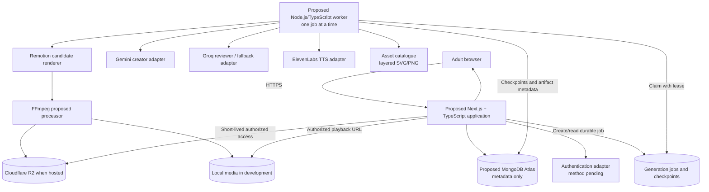
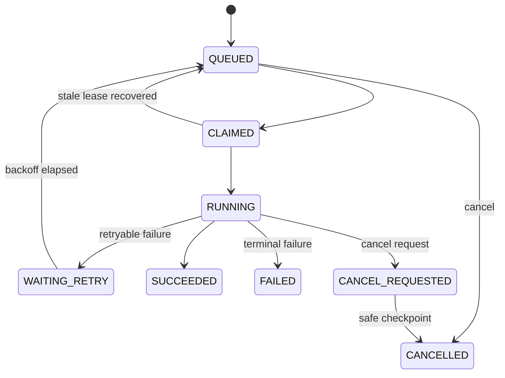

# System Design — AI Educational Story Video Platform V1

> **Confirmed visual direction (11 November 2026):** V1 produces premium cinematic 2.5D educational animation using reusable layered artwork rendered in a consistent 3D style. Character poses/expressions, educational objects, depth/parallax, lighting, particles and camera work are animated programmatically. A static still with pan/zoom does not qualify. Paid provider-generated true 3D remains an optional future adapter, not a V1 dependency.

> **Status:** Proposed design — pending relevant founder approvals.  
> **Source:** Extracted from the supplied `TECHNICAL_DESIGN.md` (10 November 2026); no new technology decisions have been approved.  
> **Authority:** `docs/PRD.md` controls scope; `docs/DECISIONS.md` controls approval status. The existing `docs/TECHNICAL_DESIGN.md` remains the original technical reference.

## Document purpose

This is the focused high-/low-level system design. It separates service responsibilities, request and media flows, durable background jobs, access control, and hardware constraints from the data model. For the detailed LLM/TTS/animation contract, consult **Section 2** of `docs/TECHNICAL_DESIGN.md`; for database fields, indexes, relationships, storage references, and lifecycle rules, consult `docs/DATABASE_DESIGN.md`. No implementation is authorized by this document.

### Canonical document ownership

| Topic | Canonical document |
|---|---|
| Product scope and acceptance | `docs/PRD.md` |
| Approval state and superseded choices | `docs/DECISIONS.md` |
| Overall component topology and responsibilities | `docs/SYSTEM_DESIGN.md` |
| Module contracts, storage mechanics and renderer details | `docs/TECHNICAL_DESIGN.md` |
| Collections, fields, indexes, relationships and data lifecycle | `docs/DATABASE_DESIGN.md` |
| HTTP resource contracts | `docs/API_DESIGN.md` |
| AI/media stages and provider boundaries | `docs/GENERATION_PIPELINE.md` |
| Security and child-safety controls | `docs/SECURITY_AND_SAFETY.md` |
| Verification approach | `docs/TESTING_STRATEGY.md` |
| Ordered implementation work | `docs/IMPLEMENTATION_ROADMAP.md` |
| Verified implementation evidence | `PROJECT_STATUS.md` |

## 1. System architecture

### 1.1 Proposed deployment shape

Use a modular monolith for the web application plus one separate background worker. This is a process boundary for long-running work, not a microservice architecture.



### 1.2 Proposed application structure

The following is a target module layout, not an instruction to scaffold before stack approval.

| Module | Responsibility | Must not do |
|---|---|---|
| Web UI | Lesson input, combined plan review, revision requests, approval, status, and playback | Run provider calls or render video in the browser |
| Server API | Authentication boundary, authorization, validation, resource CRUD, approval transaction, job creation, playback authorization | Hold an HTTP request open for TTS or rendering |
| Domain services | Lesson rules, plan versioning, approval policy, state transitions, deterministic math validation | Import provider SDKs directly |
| Provider adapters | Gemini, Groq, ElevenLabs TTS, storage, and renderer-specific translation | Leak provider response formats into domain entities |
| Persistence adapters | Metadata models, queries, atomic state transitions, leases, and idempotency records | Store large media binaries in MongoDB |
| Background worker | Claim one job, execute stages, checkpoint outputs, retry safely, and release leases | Accept user traffic or bypass authorization/approval checks |
| Render package | Scene manifests, reusable animation templates, timing conversion, and render validation | Generate educational facts independently of approved structured data |
| Shared contracts | Versioned request/response schemas, enums, error codes, and normalized timing types | Contain secrets or environment-specific values |

### 1.3 Server-side API responsibilities

- Establish an authenticated adult principal using the approved authentication method.
- Authorize every lesson, plan, job, asset reference, video, and playback request by owner.
- Validate inputs against explicit schemas and supported class/language/topic values.
- Create lesson drafts and immutable plan versions.
- Accept scoped revision instructions without mutating previously approved versions.
- Atomically freeze an approved plan and create one idempotent generation job.
- Return durable named job stages rather than fabricated progress percentages.
- Issue playback responses or short-lived signed URLs only after authorization.
- Return quickly after durable state changes; provider work runs in the worker.

### 1.4 Communication rules

| Path | Contract |
|---|---|
| Browser → API | HTTPS JSON; authenticated session; CSRF protection if cookie-based auth is selected |
| API → MongoDB | Metadata-only reads/writes; owner-scoped queries; atomic approval/job transitions |
| Worker → MongoDB | Lease-based job claim, heartbeat, bounded attempt count, stage checkpoints, sanitized errors |
| Worker → AI/TTS providers | Server-side credentials, strict timeouts, usage recording, bounded retry/backoff |
| Worker → renderer | Versioned scene manifest plus approved plan and normalized narration timing |
| Worker → media storage | Private objects; deterministic object keys; integrity metadata; no permanent public URL |
| API → media storage | Authorized stream/proxy in development or short-lived signed URL when hosted |

### 1.5 End-to-end data flow

1. Adult creates a lesson request.
2. API validates and stores the request, then creates a `PLAN_GENERATION` job.
3. Worker asks Gemini for one structured script-and-storyboard response.
4. Worker validates JSON shape, supported actions, age rules, and deterministic facts.
5. Groq reviews semantic alignment. On bounded correction, Gemini receives structured findings. If Gemini remains unavailable or invalid after allowed retry, a tested Groq fallback may produce the same schema.
6. A valid plan version becomes `REVIEW_READY`; no media generation occurs yet.
7. Adult requests revisions or atomically approves a specific plan version.
8. Approval creates one `VIDEO_GENERATION` job keyed by the approved plan version.
9. Worker resolves assets, generates narration, normalizes timing, creates a scene manifest, renders, processes, validates, and stores the final MP4.
10. API exposes job status and authorized playback; it does not expose V1 download.

## 4. API design

All endpoints are proposed under `/api/v1`. Exact authentication endpoints depend on the unresolved auth method. Every private resource query must include an owner authorization filter, not merely fetch by ID and check later.

### 4.1 Response and error conventions

Success envelope:

```json
{"data": {}, "requestId": "req_..."}
```

Error envelope:

```json
{
  "error": {
    "code": "PLAN_NOT_APPROVED",
    "message": "The selected plan version must be approved before generation.",
    "retryable": false,
    "details": []
  },
  "requestId": "req_..."
}
```

Use stable application error codes. Do not expose provider payloads, stack traces, object keys, secrets, or sensitive inputs.

### 4.2 Authentication and profile

| Method and path | Purpose | Request | Response | Authorization |
|---|---|---|---|---|
| `POST /auth/register` | Create adult account if selected auth method owns registration | Auth-provider-specific validated credentials/flow | Session principal and minimal profile | Public with rate limiting; exact route pending auth decision |
| `POST /auth/session` | Establish adult session | Provider-specific proof | Session principal | Public with rate limiting; exact route pending |
| `DELETE /auth/session` | End session | None | `204` | Authenticated adult |
| `GET /profile` | Read current profile | None | `userId`, role preference, preferred language | Authenticated adult |
| `PATCH /profile` | Change experience preferences | `{rolePreference?, preferredLanguage?}` | Updated profile | Authenticated adult; no privilege elevation |

Role preference personalizes wording/defaults and must not create separate authorization tiers in V1.

### 4.3 Lesson and plan endpoints

| Method and path | Purpose | Key request shape | Key response shape | Authorization / rules |
|---|---|---|---|---|
| `POST /lessons` | Create draft lesson | `{learnerLevel, subjectKey, topicKey, language, instruction, preferredContext?}` | `{lessonId, status: "DRAFT"}` | Authenticated adult; validate supported taxonomy and minimize child data |
| `GET /lessons` | List owned recent projects | Query: cursor, status, limit | `{items, nextCursor}` | Owner only; full library scope pending |
| `GET /lessons/{lessonId}` | Retrieve project aggregate | None | Lesson, current plan summary, current job, video summary | Owner only |
| `PATCH /lessons/{lessonId}` | Update draft input | Mutable lesson fields | Updated draft | Owner only; reject if a generation is active or preserve version semantics |
| `POST /lessons/{lessonId}/plans` | Generate script/storyboard | `{idempotencyKey}` | `{jobId, stage: "PLANNING"}` with `202` | Owner only; creates durable plan job; rate/spend checks |
| `GET /lessons/{lessonId}/plans` | List plan versions | Cursor optional | Plan summaries | Owner only |
| `GET /plans/{planId}` | Review full structured plan | None | Script, scenes, validations, findings, approval state | Owner only |
| `POST /plans/{planId}/revisions` | Request scoped natural-language revision | `{instruction, targetSceneIds?, idempotencyKey}` | `{jobId, basePlanId}` with `202` | Owner only; previous plan remains immutable |
| `POST /plans/{planId}/approval` | Approve exact version and create video job | `{contentHash, idempotencyKey}` | `{approvedPlanId, jobId}` with `202` | Owner only; atomic; reject hash mismatch or invalid plan |

Example lesson creation:

```json
{
  "learnerLevel": "CLASS_2",
  "subjectKey": "MATH",
  "topicKey": "MULTIPLICATION_EQUAL_GROUPS",
  "language": "en-IN",
  "instruction": "Explain multiplication using a rabbit and carrots.",
  "preferredContext": {"characterKey": "character.rabbit.ria"}
}
```

### 4.4 Job and playback endpoints

| Method and path | Purpose | Response | Authorization / rules |
|---|---|---|---|
| `GET /jobs/{jobId}` | Read durable named stage | `{jobId, state, stage, attempts, canCancel, error?, updatedAt}` | Owner only |
| `POST /jobs/{jobId}/cancel` | Request cancellation | `{state: "CANCEL_REQUESTED"}` | Owner only; idempotent; completes at safe checkpoint |
| `POST /jobs/{jobId}/retry` | Retry an eligible failed stage | `{newJobId}` or updated job | Owner only; bounded; disclose possible provider usage; preserve checkpoints |
| `GET /videos/{videoId}` | Retrieve authorized metadata | Topic/language/duration/status/validation summary | Owner only |
| `POST /videos/{videoId}/playback-session` | Issue playback access | Development stream URL or short-lived signed URL plus expiry | Owner only; ready video; no download disposition |

Polling is sufficient initially. Server-Sent Events may be proposed later if measured UX requires it; WebSockets are not required for V1.

### 4.5 HTTP behavior

- `201` for synchronous resource creation; `202` for durable asynchronous work.
- `400` malformed request, `401` unauthenticated, `403` unauthorized, `404` absent or inaccessible resource, `409` version/idempotency/state conflict, `422` schema/educational validation failure, `429` application quota, `503` temporary provider/worker unavailability.
- Mutation requests that can create external usage require an idempotency key.
- Pagination uses opaque cursors and bounded limits.
- API logs record request ID and sanitized resource/job IDs, not narration or child-related free text by default.

## 5. Background job architecture

### 5.1 Persistent state machine



User-facing stages are separate from machine state. A job can be `RUNNING` at `NARRATION`, `RENDERING`, or another named stage.

### 5.2 Sequential worker

- One worker process claims at most one heavy job at a time on the development laptop.
- Claim uses an atomic update from `QUEUED` to `CLAIMED` where no live lease exists.
- Worker writes `leaseOwner`, `leaseExpiresAt`, and periodic heartbeat.
- A stale-lease recovery routine returns safe jobs to `QUEUED` or marks them for manual review when stage safety is unknown.
- Do not introduce Redis/BullMQ before measured concurrency or reliability requirements justify it and approval is recorded.

### 5.3 Stage checkpoints

Each checkpoint records:

- Input content/config hash
- Stage status and attempt
- Private artifact references and checksums
- Provider/model/voice/config revision
- Usage, latency, and timestamps
- Validation summary
- Next safe stage

Recommended video stages:

1. `ASSET_RESOLUTION`
2. `NARRATION`
3. `TIMING`
4. `COMPOSITION`
5. `RENDERING`
6. `POST_PROCESSING`
7. `STORAGE`
8. `VALIDATION`

Do not delete the last successful final video until a replacement completes validation.

### 5.4 Idempotency and retry

- Plan generation key: owner + lesson + normalized input revision + operation ID.
- Video generation key: owner + approved plan ID + plan content hash + render-profile version.
- Provider cache key includes provider, exact model/voice, settings, locale, and normalized input hash.
- Retry only errors classified as transient: timeout, provider `429`, temporary `5xx`, recoverable process failure, or lease expiration.
- Use bounded exponential backoff with jitter and honor `Retry-After`.
- Validation, safety, unsupported action, authorization, licensing, and missing-approved-asset failures are not blind-retry candidates.
- Exact retry counts remain a measured Phase 0/Phase 1 decision.

### 5.5 Failure recovery and cancellation

- Preserve lesson input, all plan versions, approval evidence, successful narration/assets, and validated prior video.
- Return a stage-specific, sanitized error and whether retry may consume provider quota.
- Before rendering, cancellation can terminate at the next provider boundary.
- During rendering, set `CANCEL_REQUESTED`; stop at the next safe frame/segment/process checkpoint and clean only known temporary artifacts.
- Never expose partial or corrupt output as ready.

### 5.6 Usage and cost tracking

Record per external request:

- Provider, exact model/voice, operation, attempt
- Input/output tokens or TTS characters/audio duration
- Request latency and status
- Cache hit/miss
- Estimated cost using a versioned pricing snapshot, clearly labeled an estimate

Apply development quotas and alerts where providers support them. Paid usage requires founder approval.

## 6. Storage design

### 6.1 Development filesystem — proposed

```text
media/
  projects/{ownerScopedProjectId}/
    plans/
    narration/
    assets/
    scenes/
    previews/
    final/
```

- Generate opaque owner-scoped project IDs; never use child names in paths.
- Prevent traversal and sanitize filenames.
- Keep metadata and checksums in the database; store only media files on disk.
- Use explicit temporary directories and stage cleanup rules.
- Development filesystem storage is single-machine only and provides no public deployment durability.

### 6.2 Cloudflare R2 hosted direction

Proposed private key pattern:

```text
projects/{ownerId}/{lessonId}/{artifactType}/{artifactVersion}/{opaqueFilename}
```

- Buckets remain private.
- Store only the bucket/object key and checksum in MongoDB, never a permanent public URL.
- API authorizes the owner, then issues a short-lived signed playback URL or controlled stream.
- Playback response must not set a user-facing download disposition in V1.
- Validate object checksum, content type, size, and expected media streams before marking ready.
- CORS must allow only approved application origins and methods.

### 6.3 Unresolved lifecycle policy

The following must be approved before invited beta:

- Retention for temporary frames, scene renders, narration, failed jobs, and final videos
- Signed URL lifetime
- Final-video expiry and long-term availability promise
- Project deletion and deletion propagation
- Backup/recovery scope and schedule
- Storage/request/egress ceilings and alert thresholds
- Treatment of cached provider artifacts shared across revisions

Until approved, do not promise indefinite storage or implement irreversible automated deletion.

## 7. Security and educational safety

### 7.1 Authentication and authorization

- Authentication method remains open; use an established library/provider after approval rather than implementing password cryptography directly.
- Accounts are adult-operated. Parent/Teacher is a preference, not a privilege tier.
- Every owner-scoped query includes `ownerId` from the server-established principal.
- Use secure, HTTP-only, same-site cookies if cookie sessions are selected; apply CSRF protection to state-changing routes.
- Rate-limit authentication, generation, approval, retry, and playback-session endpoints.
- Prevent object-ID enumeration by returning the same inaccessible/not-found behavior.

### 7.2 Provider and application secrets

- Store keys only in server/worker secret configuration.
- Never expose keys to browser bundles, repository files, logs, rendered video, or error responses.
- Separate development and hosted credentials and restrict each key to required permissions.
- Rotate credentials after suspected disclosure.

### 7.3 Input and render safety

- Validate JSON shapes, enum values, lengths, Unicode, MIME types, and size limits.
- Escape or sanitize user/LLM text before HTML, SVG, subtitle, filename, shell, and renderer use.
- Invoke FFmpeg/process APIs with structured arguments; never build shell commands from user text.
- Reject unknown animation actions and unapproved asset references.
- Verify asset integrity hash and license/approval state before final rendering.

### 7.4 Child-data minimization

- Store class/age band, subject, topic, language, and learning instruction only as needed.
- Do not require child name, birthday, school, photo, voice, or location.
- Do not implement child history, profiling, targeted advertising, or child accounts.
- Keep free-text inputs out of routine logs.
- Retention, consent, deletion, and qualified legal review remain open before public use.

### 7.5 Educational correctness

Validation order:

1. Structured schema
2. Supported taxonomy and scene actions
3. Deterministic equations, counts, groups, units, and sequences
4. Age/language heuristics
5. Groq semantic review
6. Sensitive-topic policy
7. Adult review and explicit approval

The semantic reviewer cannot certify truth, and adult approval does not replace deterministic checks. A valid render must fail if displayed quantities disagree with the approved structured facts.

## 8. Performance and budget

### 8.1 Development constraints

| Constraint | Design response |
|---|---|
| Windows laptop, 8 GB RAM, Intel Iris Xe | One worker and one heavy operation at a time; no local generative video or large local LLM dependency |
| Zero-cost-first | Reusable assets, deterministic layouts, local rendering, caching, provider free tiers within current terms |
| Quality requirement | Draft previews may be lower quality only if approved/labeled; final validation targets native 1080p pending formal approval |
| Variable lesson duration | Derive duration from approved narration and comprehension holds; exact policy pending approval |
| Limited storage | Delete/reuse intermediates only under an approved lifecycle policy; record output sizes during POC |

### 8.2 Rendering profile

- POC must include at least one native 1080p final render if the pending quality requirement is approved.
- Aspect ratio and 24/30 FPS remain open; use an explicitly labeled test profile rather than implying a product decision.
- Prefer SVG/procedural assets for sharp scaling and low memory.
- Avoid holding all frames in memory; let the candidate renderer/encoder stream or batch frames according to measured behavior.
- Record peak process and system RAM, CPU utilization where available, render time, output size, and failures.

### 8.3 Cost controls

- Require adult approval before TTS and rendering.
- Cache plan, narration, asset, and render-stage outputs using content/config hashes.
- Regenerate only affected stages after a revision.
- Bound retries and prevent duplicate approval jobs.
- Track tokens, characters, requests, output duration, storage, and estimated cost.
- Do not introduce paid tiers, licensed assets, hosted workers, or mandatory subscriptions without founder approval.

## 9. Proof of concept

### 9.1 Experiment

> Teach Class 2 multiplication using a rabbit and carrots.

The POC is pending founder approval. It validates the risky pipeline, not the complete SaaS application. Authentication, dashboard polish, R2 hosting, full project library, and production deployment are unnecessary for the smallest local proof.

### 9.2 Minimum POC implementation

| Component | Minimum experiment |
|---|---|
| Structured input | Fixed Class 2 multiplication request in English and equivalent Hindi request |
| Gemini creator | Produce one schema-valid script/storyboard per language using the same lesson facts |
| Groq reviewer | Return structured alignment/age/factual findings; simulate Gemini failure and verify fallback schema behavior |
| Deterministic validator | Assert three groups × two carrots = six; validate every scene count and equation |
| Assets | One reusable layered rabbit, carrot, basket, background, and programmatic labels; recorded provenance/license |
| ElevenLabs narration | Generate English and Hindi audio plus timestamp alignment; compare candidate voices within the free internal-evaluation quota |
| Synchronization | Map key phrases to group reveal, carrot distribution, repeated addition, equation, captions, and comprehension hold |
| Remotion candidate | Render controlled motion, pose swaps, labels, captions, and transitions |
| FFmpeg proposed processing | Inspect, encode/process, normalize audio if needed, and validate output streams/file integrity |
| Output | Draft iterations plus one final 1080p test profile if approved; no user-facing download feature |
| Measurements | Schema validity, corrections, provider usage, latency, pronunciation review, peak RAM, render time, size, sync defects, and failure points |

### 9.3 Suggested scene test

1. Rabbit introduces the problem.
2. Three baskets appear.
3. Two carrots are placed in each basket, synchronized with narration.
4. `2 + 2 + 2 = 6` appears programmatically.
5. `3 × 2 = 6` appears with a short recap.

Every quantity comes from structured numeric facts. The asset generator or LLM does not decide how many objects appear.

### 9.4 POC evidence and exit gate

| Area | Required evidence |
|---|---|
| Educational correctness | Automated assertions plus adult confirmation of every count and equation |
| Plan quality | Schema-valid English/Hindi plans with narration and visual intent aligned per scene |
| Semantic review | Reviewer findings are useful; false positives and fallback behavior are recorded |
| Voice | Fluent English/Hindi reviewers assess pronunciation, pacing, numerals, equations, warmth, and glitches |
| Synchronization | Human review confirms key actions/captions align; proposed timing tolerance comes from observed output |
| Visual quality | Same rabbit style across scenes; sharp text/assets; motion supports learning rather than resembling a slideshow |
| Render feasibility | Complete render without system instability; peak RAM, time, output size, and failures recorded |
| Cost visibility | Every external request and estimated cost/usage recorded |
| Extensibility | One approved transfer topic can reuse the schema and at least some templates/assets |

The POC outcome is a go/change/stop recommendation. It does not by itself approve the full application stack or production providers.

## 10. Open technical decisions

| ID | Decision / validation | Current status | Needed before |
|---|---|---|---|
| OT-001 | Approve the rabbit-and-carrots POC, success criteria, and transfer topic | Pending founder approval | Phase 0 implementation |
| OT-002 | Approve or revise Next.js + TypeScript application structure | Proposed | Phase 1 scaffolding |
| OT-003 | Approve MongoDB Atlas + Mongoose and resolve its inconsistent PRD status | Proposed/inconsistent | Persistence implementation |
| OT-004 | Approve separate Node.js/TypeScript worker and persistence approach | Proposed | Background processing implementation |
| OT-005 | Select authentication method and session model | Open | Phase 1 authentication |
| OT-006 | Pin Gemini creator model/configuration | Approved direction; exact selection open | POC exit |
| OT-007 | Pin Groq reviewer/fallback model, thresholds, and activation policy | Approved direction; exact selection open | POC exit |
| OT-008 | Pin ElevenLabs model and English/Hindi voices; validate quota, timing, privacy, and production suitability | Internal Phase 0 evaluation direction approved; exact selection and commercial use open | POC exit/beta |
| OT-009 | Define structured plan schema version 1 and supported action vocabulary | Not defined | POC start |
| OT-010 | Define supported math/topic scope and deterministic assertions | Open | POC start |
| OT-011 | Approve Remotion evaluation and verify current commercial eligibility | Candidate | POC implementation/public use |
| OT-012 | Approve FFmpeg evaluation; document build flags, codecs, and distribution obligations | Proposed | POC implementation/distribution |
| OT-013 | Choose final aspect ratio and whether V1 supports one or both formats | Open | POC exit/UI design |
| OT-014 | Choose 24 or 30 FPS | Open | POC exit |
| OT-015 | Approve native 1080p minimum as binding | Pending founder approval | POC final validation |
| OT-016 | Approve content-driven duration and split guidance | Pending founder approval | Planning rules |
| OT-017 | Define synchronization tolerance and caption presentation rules | Requires POC evidence | POC exit |
| OT-018 | Approve adult gate as mandatory/non-bypassable | Approval inconsistency | Media-generation implementation |
| OT-019 | Define sensitive-topic moderation policy and owner | Open | Beta |
| OT-020 | Approve child-data minimization and personalization policy | Pending | UX/data implementation |
| OT-021 | Define R2 bucket, CORS, signed URL lifetime, lifecycle, limits, and pricing | Direction approved; configuration open | Invited beta |
| OT-022 | Define retention/deletion, project deletion, backups, and long-term availability | Open | Invited beta |
| OT-023 | Decide recent-project list versus full library and sharing-link scope | Open | Storage UI/API |
| OT-024 | Set retry counts, daily quotas, beta spend ceilings, concurrency, and latency targets | Requires measurements | Invited beta |
| OT-025 | Verify commercial licenses for providers, models, voices, assets, fonts, music, Remotion, FFmpeg, and codecs | Open | Public/commercial use |
| OT-026 | Approve privacy/legal position and consent/deletion behavior | Open | Public beta |

## 11. Design constraints summary

- Keep one web application and one worker process; do not introduce microservices, Kubernetes, Kafka, or mandatory Docker.
- Do not introduce Redis/BullMQ until actual concurrency or recovery evidence justifies it and approval is recorded.
- Keep external providers replaceable behind typed adapters.
- Keep media private and metadata-only in the database.
- Keep educational facts structured, deterministic, testable, and adult-reviewed.
- Keep script and storyboard coherent by generating them together.
- Preserve successful checkpoints and the last valid output.
- Prefer zero-cost tools, but never silently lower educational, visual, narration, synchronization, privacy, or security quality.

